# Socle commun — Infrastructure DEVIDA

[Retour au sommaire](../README.md)

## 1. Contexte et périmètre

Les deux AP reposent sur un laboratoire hébergé dans Proxmox. pfSense assure le routage entre les réseaux et le filtrage des communications. Le domaine `DEVIDA.local` fournit les identités et la résolution DNS nécessaires aux postes et aux services.

Les captures plus anciennes montrent un environnement `NEXA.local` sur 192.168.100.0/24. Ces images ne sont pas utilisées comme preuve de la configuration finale DEVIDA. De même, les anciens identifiants de VM ont changé au cours du laboratoire : les rapports utilisent les numéros 500 à 508 identifiés dans la phase finale.

## 2. Réseaux et machines

| Réseau | Utilisation | Passerelle |
| --- | --- | --- |
| 192.168.100.0/24 | Administration et accès à Proxmox | 192.168.100.1 |
| 10.2.61.0/24 — VLAN 500 | AD, postes, stockage, Guacamole et supervision | 10.2.61.1 |
| 10.2.62.0/24 — VLAN 510 | Téléphonie | 10.2.62.1 |

| VM | Nom / fonction | Adresse connue |
| --- | --- | --- |
| 500 | AD-DEVIDA — Windows Server 2022, DNS et DHCP | 10.2.61.100 |
| 501 | AD-DEVIDA-second — second serveur référencé dans les DNS | 10.2.61.101 |
| 502 | TrueNAS — stockage | 10.2.61.125 |
| 503 | USER-AD-DEVIDA — poste Windows accessible en RDP | 10.2.61.126 |
| 504 | DEB-DEVIDA — poste Debian du domaine | Adresse finale non établie |
| 505 | SRV-TEL-DEVIDA — FreePBX | 10.2.62.10 |
| 506 | Second poste de test | Adresse finale non établie |
| 507 | SRV-GUAC-DEVIDA — portail RDP/SSH | 10.2.61.121 |
| 508 | SRV-SUPERVISION-DEVIDA — Grafana/Prometheus | 10.2.61.123 |

La présence du second AD dans la configuration DNS ne prouve pas une réplication fonctionnelle ou une haute disponibilité testée. La supervision montrée porte sur le serveur 10.2.61.100.

## 3. Bridge et VLAN

Le bridge `vmbr2` est configuré pour transporter les VLAN. La carte réseau de chaque VM reçoit une étiquette : 500 pour les services DEVIDA, 510 pour la téléphonie. La VM pfSense dispose d’une interface parent `vtnet2` sur laquelle les interfaces VLAN sont créées.

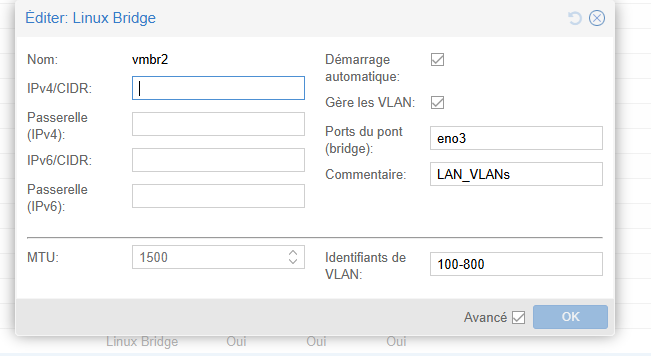

*Figure 168 — Bridge vmbr2 compatible VLAN sur Proxmox. Source : `Screenshots/Capture d'écran 2026-10-22 095122.png`.*

Le marquage VLAN est réalisé dans Proxmox pour les VM clientes. Il n’est donc pas nécessaire de créer une sous-interface VLAN dans Debian pour ces cartes virtuelles. Les règles pfSense restent indispensables pour autoriser les flux entre les réseaux.

## 4. DNS, DHCP et identité

Le domaine est `DEVIDA.local`. Les DNS du laboratoire sont 10.2.61.100 et 10.2.61.101. Guacamole et le serveur de supervision utilisent des réservations DHCP pour conserver une adresse stable tout en restant configurés en DHCP.

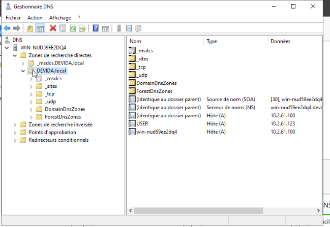

*Figure 064 — Zone DNS DEVIDA.local et enregistrements du laboratoire. Source : `Screenshots/Capture d'écran 2026-10-02 122913.png`.*

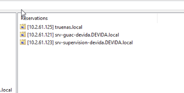

*Figure 378 — Réservations DHCP de Guacamole, TrueNAS et du serveur de supervision. Source : `Screenshots/Capture d'écran 2026-11-19 145910.png`.*

La réservation associe l’adresse MAC de la VM à l’IPv4 souhaitée. Une adresse stable est nécessaire pour les connexions Guacamole, les cibles Prometheus et les règles de pare-feu.

Un poste Debian a également été joint au domaine avec `realmd`/SSSD. La preuve disponible montre le domaine et les paramètres de connexion autorisés :

```bash
# Contrôle observé sur le poste Debian du domaine
/usr/sbin/realm list
```

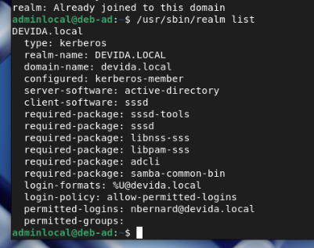

*Figure 071 — Client Debian déjà membre du domaine DEVIDA.local ; résultat de realm list. Source : `Screenshots/Capture d'écran 2026-10-02 140153.png`.*

Ce poste est distinct des serveurs Debian Guacamole et supervision. Leur installation ne prouve pas qu’ils ont eux-mêmes été joints au domaine.

## 5. TrueNAS : travaux complémentaires du socle

TrueNAS apparaît dans l’archive mais ne constitue pas le sujet principal d’AP1 ou AP2. Les éléments ci-dessous sont conservés pour expliquer l’environnement de stockage.

L’installation s’est terminée avec succès ; une réservation DHCP a ensuite fixé l’adresse 10.2.61.125.

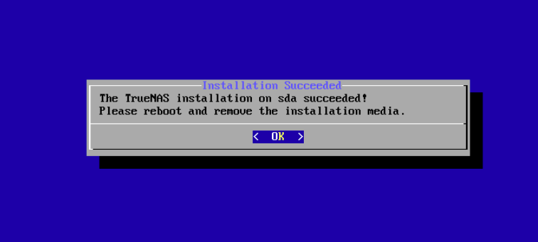

*Figure 084 — Fin de l’installation TrueNAS ; composant du socle, distinct des deux AP. Source : `Screenshots/Capture d'écran 2026-10-08 151011.png`.*

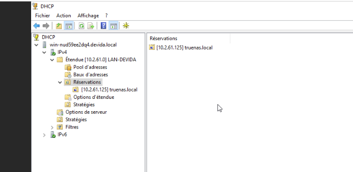

*Figure 090 — Réservation DHCP de TrueNAS à l’adresse 10.2.61.125. Source : `Screenshots/Capture d'écran 2026-10-08 152606.png`.*

La création du pool a rencontré l’erreur « Disks have duplicate serial numbers ». Les disques virtuels n’avaient pas de numéros de série distincts. La capture suivante montre la correction sur l’ancien identifiant de VM 118 ; ce numéro ne doit pas être réutilisé sans vérifier l’identifiant actuel.

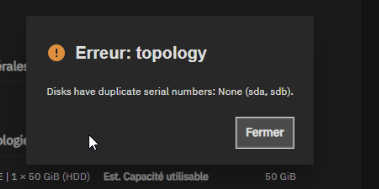

*Figure 101 — Erreur TrueNAS signalant des numéros de série de disques identiques. Source : `Screenshots/Capture d'écran 2026-10-08 160222.png`.*

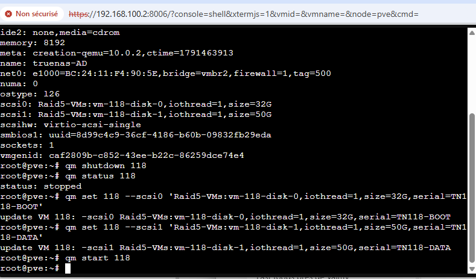

*Figure 105 — Ajout de numéros de série distincts aux disques virtuels TrueNAS. Source : `Screenshots/Capture d'écran 2026-10-08 161220.png`.*

Le pool `DATA-DEVIDA` a ensuite été créé, avec un dataset `PARTAGE` prévu pour SMB.

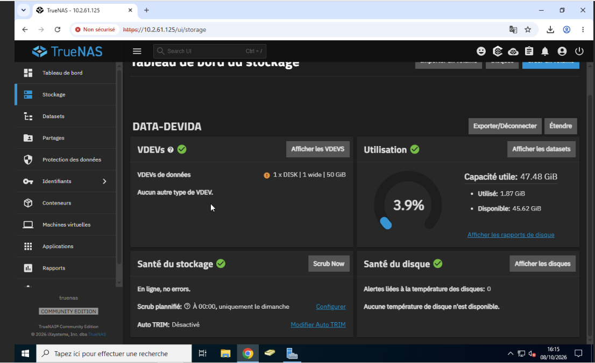

*Figure 106 — Pool DATA-DEVIDA créé ; un seul disque de données, sans redondance à ce niveau. Source : `Screenshots/Capture d'écran 2026-10-08 161604.png`.*

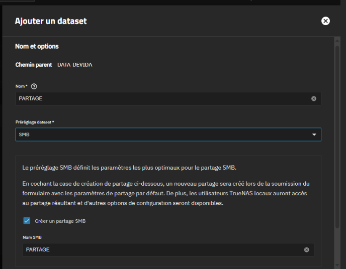

*Figure 108 — Création du dataset PARTAGE avec un préréglage SMB. Source : `Screenshots/Capture d'écran 2026-10-08 162121.png`.*

Le pool représenté n’a qu’un disque de données : il n’offre pas de redondance ZFS à ce niveau. Le stockage physique de l’hyperviseur ne transforme pas ce pool en miroir ou RAID-Z et ne remplace pas une sauvegarde.

Les DNS et la passerelle ont été adaptés au domaine ; l’intégration à l’annuaire finit par afficher `HEALTHY`.

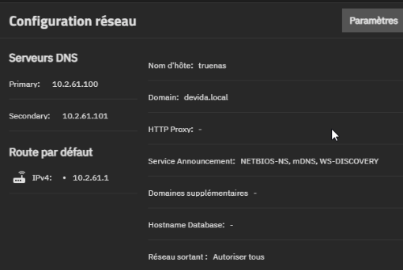

*Figure 120 — DNS et passerelle configurés sur TrueNAS pour le domaine DEVIDA.local. Source : `Screenshots/Capture d'écran 2026-10-08 164815.png`.*

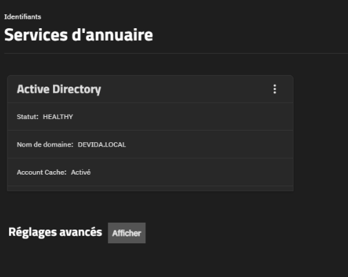

*Figure 133 — Service d’annuaire TrueNAS affiché HEALTHY après la configuration AD. Source : `Screenshots/Capture d'écran 2026-10-08 170216.png`.*

Ces preuves démontrent la création du pool/dataset et l’état du service d’annuaire à cet instant. Elles ne démontrent pas un test complet des droits SMB, de restauration ou de continuité de service.

## 6. Contrôles réseau réutilisables

Les commandes suivantes constituent une fiche de vérification ; les exécuter uniquement sur la machine concernée.

```bash
# Debian : adresse, route et DNS
ip -br address
ip route
cat /etc/resolv.conf
```

```powershell
# Windows : paramètres réseau et identité
ipconfig /all
whoami
# Exemple : vérifier l'accès à l'interface Guacamole
Test-NetConnection 10.2.61.121 -Port 8080
```

Un ping réussi ne garantit pas qu’un service web répond. Il faut vérifier le port, puis le protocole applicatif. Cette distinction a été utilisée pendant l’incident Guacamole et le diagnostic d’accès FreePBX.
