# AP1 — Déploiement d’un standard téléphonique FreePBX

> **En langage simple.** Le but est de faire communiquer deux personnes avec des numéros internes, comme dans une entreprise. FreePBX sert à régler le standard et Asterisk établit les appels. Vous allez suivre la création du serveur, des numéros 201 et 202, puis les essais. Le projet porte sur des appels internes, sans abonnement à un opérateur téléphonique.
>
> Première lecture : les explications et les captures suffisent. Pour les mots nouveaux, ouvrez le [lexique](../LEXIQUE.md) ou le [parcours de découverte](../GUIDE-DEBUTANT.md).

[Sommaire général](../README.md) · [Infrastructure commune](../00-Infrastructure/README.md) · [Commandes de diagnostic](configurations/diagnostic.sh)

**Période documentée : octobre 2026.** Les captures décisives datent des 16, 22, 23 et 29 octobre. Les vérifications ultérieures ne sont pas confondues avec l’installation initiale.

## Sommaire

1. [Besoin et objectifs](#1-besoin-et-objectifs)
2. [Architecture et ressources](#2-architecture-et-ressources)
3. [Réseau voix dans pfSense](#3-réseau-voix-dans-pfsense)
4. [Création de la VM et installation Debian](#4-création-de-la-vm-et-installation-debian)
5. [Installation et dépannage FreePBX](#5-installation-et-dépannage-freepbx)
6. [Configuration du standard](#6-configuration-du-standard)
7. [Clients et validation des appels](#7-clients-et-validation-des-appels)
8. [Sauvegarde](#8-sauvegarde)
9. [Accès distant Tailscale](#9-accès-distant-tailscale)
10. [Recette, limites et bilan](#10-recette-limites-et-bilan)

## 1. Besoin et objectifs

Le besoin est de disposer d’un standard téléphonique IP interne permettant à deux postes de communiquer. Le projet doit permettre d’administrer les comptes téléphoniques, d’isoler le serveur dans un réseau voix et de vérifier les appels. Un accès distant et une sauvegarde complètent l’exploitation.

FreePBX apporte l’interface d’administration ; Asterisk assure les fonctions téléphoniques. Les numéros internes sont des extensions PJSIP. Le projet ne comprend pas de raccordement opérateur ni d’appels facturés vers le réseau téléphonique public.

| Objectif | Critère de réussite |
| --- | --- |
| Installer le serveur | Debian démarre et l’interface FreePBX est accessible |
| Créer deux comptes téléphoniques | Extensions 201 et 202 présentes |
| Établir un appel interne | Appel connecté et conversation audible aux deux extrémités |
| Permettre l’administration distante | Accès au serveur via les routes Tailscale autorisées |
| Sauvegarder la configuration | Archive de sauvegarde visible dans FreePBX |

## 2. Architecture et ressources

| Paramètre | Valeur retenue |
| --- | --- |
| VM / nom | 505 — SRV-TEL-DEVIDA |
| Système | Debian 12 ; ISO visible : 12.15.0 amd64 netinst |
| CPU / mémoire | 2 cœurs / 4096 Mio |
| Disque | **40 Go** dans le récapitulatif final de création |
| Contrôleur | VirtIO SCSI single |
| Carte réseau | VirtIO, bridge vmbr2, VLAN 510 |
| Adresse | 10.2.62.10/24 sur ens18 |
| Passerelle | 10.2.62.1 |
| DNS du laboratoire | 10.2.61.100 et 10.2.61.101 |
| Logiciels | FreePBX 17, framework 17.0.33.2 ; Asterisk 22.11.0 |
| Administration web | http://10.2.62.10/admin |
| Compte Linux | adminlocal ; secret non reproduit |

Le récapitulatif de VM fait foi pour la taille du disque : une étape intermédiaire montrait 32 Go, mais la validation finale indique 40 Go.

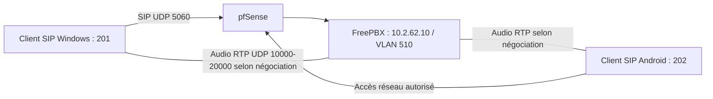

Les ports SIP servent à établir les appels ; les ports RTP transportent l’audio. Autoriser seulement SIP peut donc permettre l’enregistrement d’un poste tout en laissant les appels sans son.

## 3. Réseau voix dans pfSense

Dans **Interfaces → Assignments → VLANs**, un VLAN portant l’identifiant `510` est créé sur `vtnet2` et nommé `VOIX_DEVIDA`. Il est ensuite affecté à une interface, activé et configuré en IPv4 statique avec `10.2.62.1/24`.

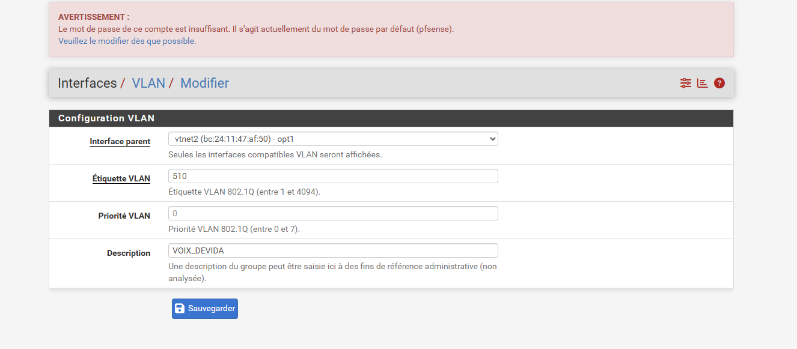

*Figure 144 — Création du VLAN 510 VOIX_DEVIDA sur l’interface parent vtnet2 de pfSense. Source : `Screenshots/Capture d'écran 2026-10-16 123111.png`.*

> **Comment lire cette capture :** Le numéro 510 identifie le réseau réservé à la voix. L’avertissement de mot de passe par défaut visible sur cet écran décrit un état intermédiaire : un tel réglage doit être remplacé avant exploitation. La preuve de ce changement n’est pas fournie.

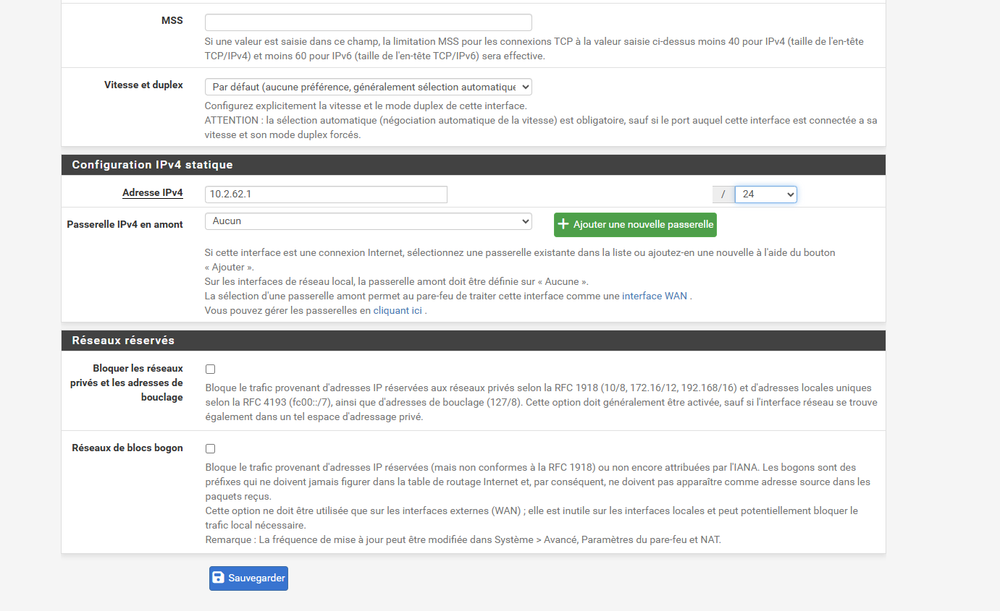

*Figure 148 — Adresse de passerelle 10.2.62.1/24 de l’interface voix. Source : `Screenshots/Capture d'écran 2026-10-16 123630.png`.*

Des règles de sortie sont ajoutées sur l’interface voix pour permettre au serveur de résoudre les noms, de télécharger ses paquets et de synchroniser l’heure. Les captures montrent des autorisations DNS vers les DNS internes, HTTP/HTTPS et NTP.

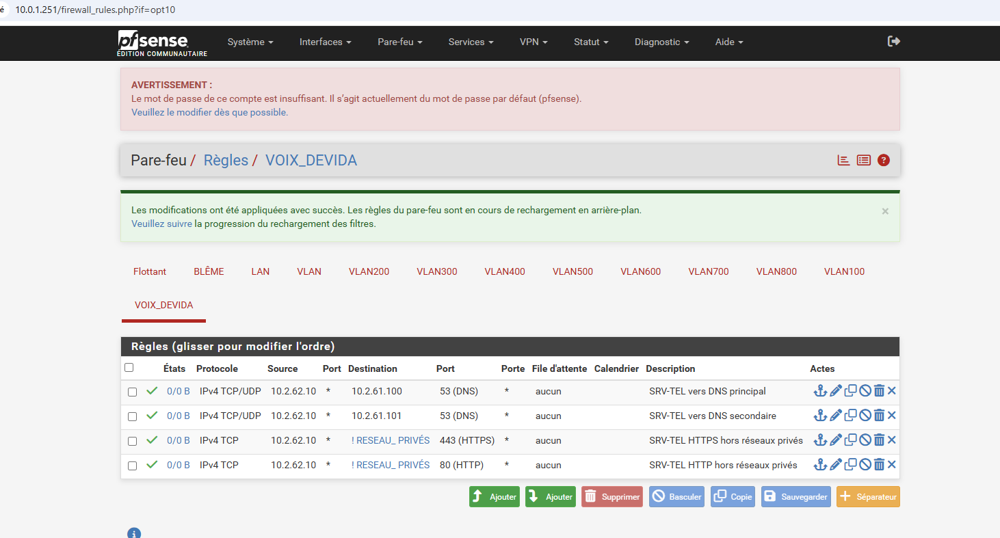

*Figure 163 — Règles de sortie de l’interface VOIX_DEVIDA : DNS, HTTP/HTTPS et NTP. Source : `Screenshots/Capture d'écran 2026-10-22 093825.png`.*

| Flux nécessaire | Utilité |
| --- | --- |
| Serveur téléphonique → DNS internes, TCP/UDP 53 | Résolution des noms |
| Serveur → dépôts logiciels, TCP 80/443 | Installation et mises à jour |
| Serveur → source de temps, UDP 123 | Synchronisation horaire |
| Clients autorisés → serveur, UDP 5060 | Signalisation SIP |
| Clients et serveur, UDP dans la plage RTP configurée | Audio |
| Poste d’administration → serveur, TCP 80 et SSH 22 | Administration dans le laboratoire |

Cette table décrit les besoins. Elle n’est pas un export exhaustif des règles réellement installées sur toutes les interfaces pfSense. Les captures retenues établissent les règles de sortie du réseau voix ; les accès clients doivent aussi être autorisés sur leur interface d’entrée.

## 4. Création de la VM et installation Debian

Dans Proxmox, **Créer VM**, renseigner le nom, choisir l’ISO Debian 12, définir les ressources et affecter la carte à `vmbr2` avec le tag VLAN `510`. Le disque est placé sur le stockage `Raid5-VMs`.

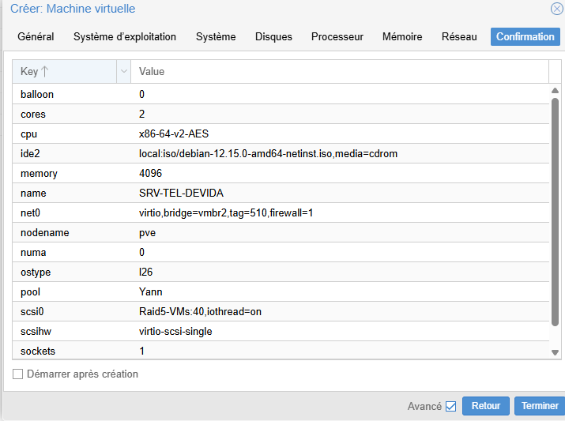

*Figure 183 — Récapitulatif de création de SRV-TEL-DEVIDA : 2 cœurs, 4096 Mio, disque 40 Go et VLAN 510. Source : `Screenshots/Capture d'écran 2026-10-22 104422.png`.*

> **Comment lire cette capture :** Les lignes cores, memory et disque indiquent les ressources attribuées à cet ordinateur virtuel. Ce sont des ressources du serveur physique partagées avec les autres machines.

L’installateur Debian a d’abord échoué à obtenir automatiquement une adresse. Le réseau a donc été configuré manuellement dans la VM.

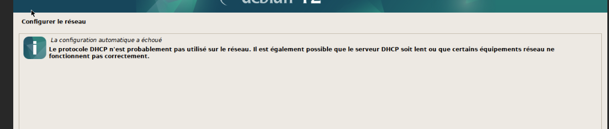

*Figure 186 — Échec de l’autoconfiguration DHCP pendant l’installation du serveur téléphonique. Source : `Screenshots/Capture d'écran 2026-10-22 105024.png`.*

> **Comment lire cette capture :** Le serveur n’a pas reçu automatiquement ses paramètres réseau. Cet échec explique la saisie manuelle de l’adresse, de la passerelle et des serveurs DNS dans les étapes suivantes.

Les paramètres sont `10.2.62.10`, masque `255.255.255.0`, passerelle `10.2.62.1`, puis les DNS internes.

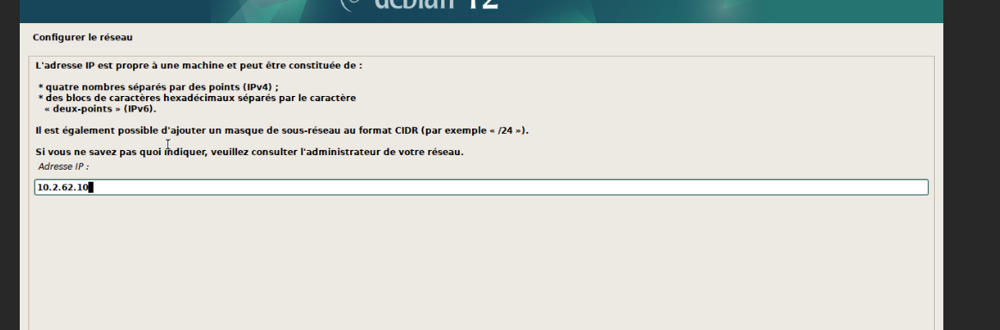

*Figure 188 — Saisie de l’adresse IPv4 du serveur téléphonique dans l’installateur. Source : `Screenshots/Capture d'écran 2026-10-22 105239.png`.*

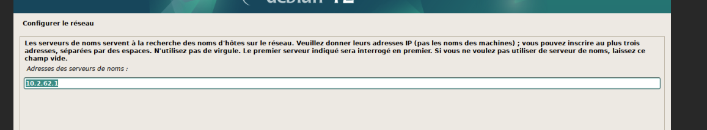

*Figure 191 — Configuration des serveurs DNS pendant l’installation Debian. Source : `Screenshots/Capture d'écran 2026-10-22 105310.png`.*

Le nom de machine devient `srv-tel-devida`, le domaine de recherche `devida.local` et le compte courant `adminlocal`. Les mots de passe ne sont pas documentés dans le dépôt.

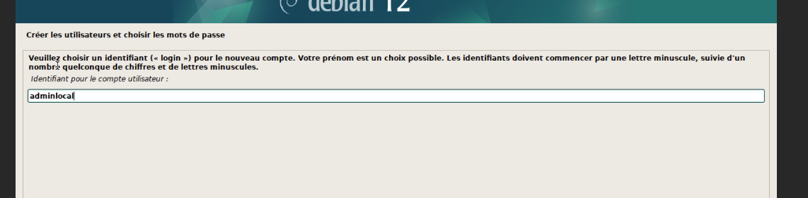

*Figure 201 — Création du compte Linux adminlocal. Source : `Screenshots/Capture d'écran 2026-10-22 160503.png`.*

Le partitionnement assisté utilise le disque de cette VM. Les changements sont validés après lecture du récapitulatif. À la sélection des logiciels, seuls le serveur SSH et les utilitaires usuels sont retenus : FreePBX est administré depuis un navigateur, sans besoin de bureau graphique sur le serveur.

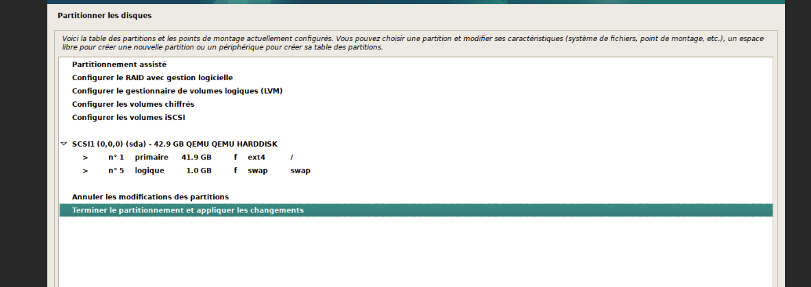

*Figure 206 — Partitionnement du disque de la VM de téléphonie avant validation. Source : `Screenshots/Capture d'écran 2026-10-22 161023.png`.*

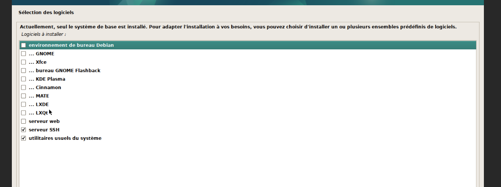

*Figure 211 — Sélection des composants Debian : serveur SSH et utilitaires usuels, sans bureau graphique. Source : `Screenshots/Capture d'écran 2026-10-22 162052.png`.*

Après redémarrage, les contrôles observés sont :

<details>
<summary>Voir les commandes ou le détail technique</summary>

```bash
ip -br address
ip route
sudo apt update
```


</details>
`ip -br address` confirme l’adresse sur `ens18`. `ip route` confirme la route par défaut vers `10.2.62.1`. Le succès d’APT valide l’accès aux dépôts à cet instant.

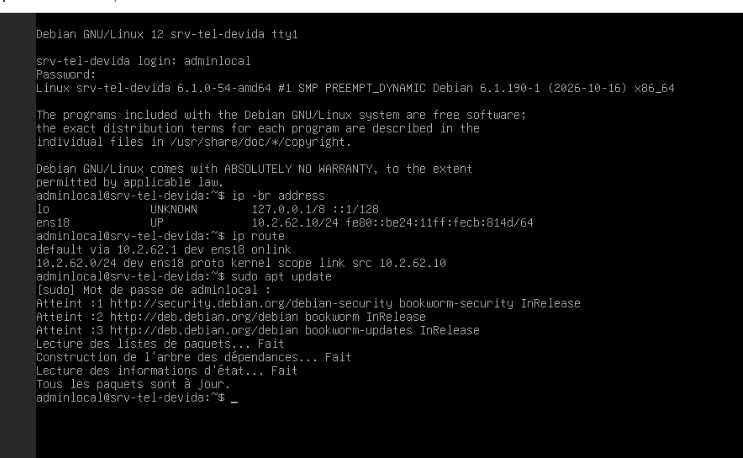

*Figure 216 — Contrôle après installation : 10.2.62.10/24, passerelle 10.2.62.1 et mise à jour APT. Source : `Screenshots/Capture d'écran 2026-10-22 162933.png`.*

## 5. Installation et dépannage FreePBX

### 5.1. Installation de référence

L’installation observée se termine par le script FreePBX 17 et indique Asterisk 22.11.0. La ligne exacte de téléchargement initial n’est pas conservée dans une capture retenue. Les commandes ci-dessous sont donc **reconstituées pour reproduction sur une nouvelle VM Debian 12**, depuis le [dépôt officiel FreePBX](https://github.com/FreePBX/sng_freepbx_debian_install). Elles ne doivent pas être relancées aveuglément sur le serveur déjà installé.

<details>
<summary>Voir les commandes ou le détail technique</summary>

```bash
# À exécuter seulement lors d'une nouvelle installation
sudo apt update
sudo apt install -y wget ca-certificates
wget https://github.com/FreePBX/sng_freepbx_debian_install/raw/master/sng_freepbx_debian_install.sh \
  -O /tmp/sng_freepbx_debian_install.sh
# Examiner le script téléchargé avant son exécution
less /tmp/sng_freepbx_debian_install.sh
sudo bash /tmp/sng_freepbx_debian_install.sh
```


</details>
La branche `master` peut évoluer : elle ne garantit pas de réinstaller exactement les versions d’octobre 2026. Pour une reproduction stricte, il faudrait conserver le script historique et son empreinte. Les journaux de l’installateur se trouvent dans `/var/log/pbx/freepbx17-install.log`.

### 5.2. Incident de téléchargement de modules

Le premier passage échoue pendant l’installation de modules. Des essais `curl` montrent des délais d’attente vers le miroir FreePBX. Des tests PHP ont également rencontré une erreur de syntaxe : celle-ci appartient au diagnostic et ne doit pas être recopiée comme procédure d’installation.

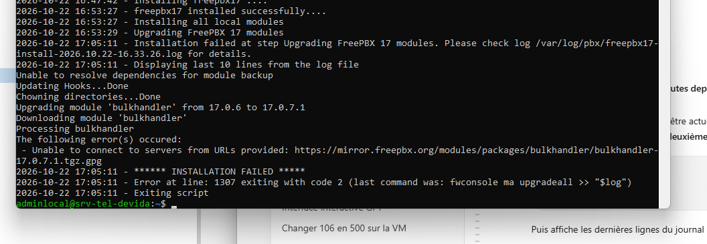

*Figure 218 — Échec intermédiaire de l’installation FreePBX lors du téléchargement d’un module. Source : `Screenshots/Capture d'écran 2026-10-22 170701.png`.*

La séquence de correction effectivement visible est :

<details>
<summary>Voir les commandes ou le détail technique</summary>

```bash
sudo fwconsole setting PROXY_ENABLED 0
sudo fwconsole -vvv ma downloadinstall bulkhandler
```


</details>
La première commande désactive l’utilisation du proxy par FreePBX. La seconde télécharge et installe le module `bulkhandler` en affichant des détails. Le journal confirme l’installation de la version 17.0.7.1 de ce module. Le proxy et les délais réseau ont été explorés ; les captures ne permettent pas d’attribuer tous les échecs à une cause unique.

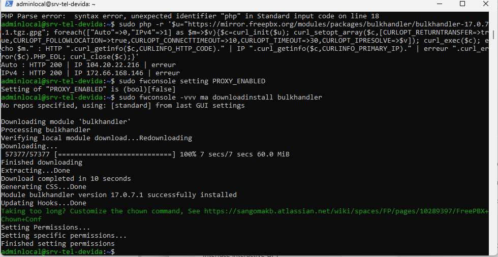

*Figure 224 — Désactivation du proxy FreePBX et installation réussie du module bulkhandler. Source : `Screenshots/Capture d'écran 2026-10-22 171749.png`.*

L’installation atteint ensuite son message de fin :

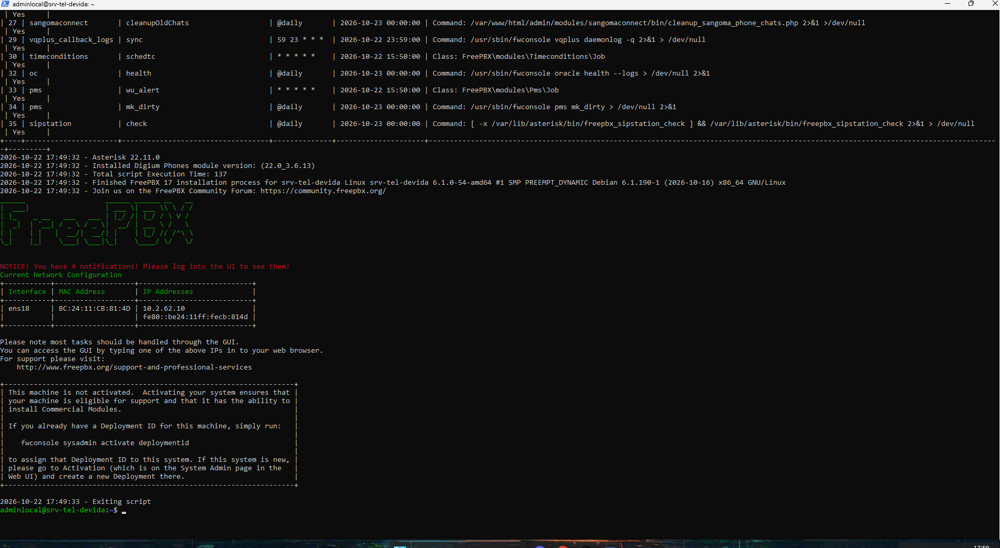

*Figure 240 — Fin de l’installation FreePBX 17 avec Asterisk 22.11.0. Source : `Screenshots/Capture d'écran 2026-10-22 175046.png`.*

### 5.3. Première ouverture de l’interface

Depuis un poste autorisé, ouvrir `http://10.2.62.10/admin`. L’assistant permet de créer l’administrateur web, de définir le nom du système et les paramètres de notification. Les identifiants web et Linux sont des comptes distincts, même lorsqu’un nom identique est utilisé.

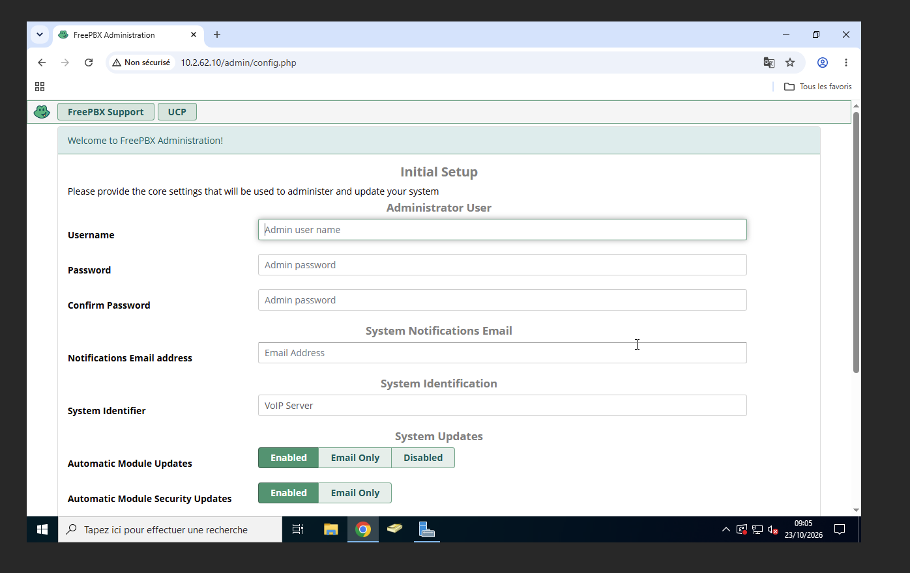

*Figure 241 — Assistant de première configuration de l’administration FreePBX. Source : `Screenshots/Capture d'écran 2026-10-23 090549.png`.*

Les options de langue sont définies, puis l’assistant de pare-feu est parcouru. Le tableau de bord devient accessible.

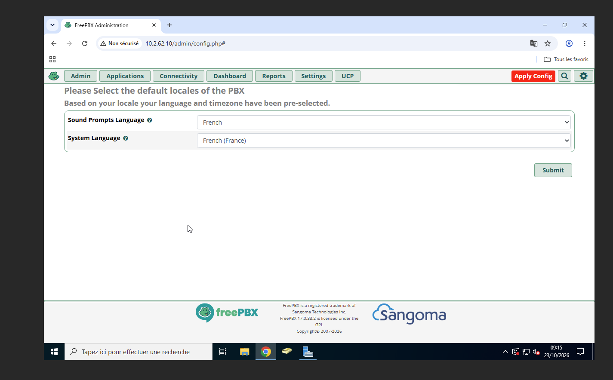

*Figure 245 — Choix des paramètres de langue de FreePBX. Source : `Screenshots/Capture d'écran 2026-10-23 091532.png`.*

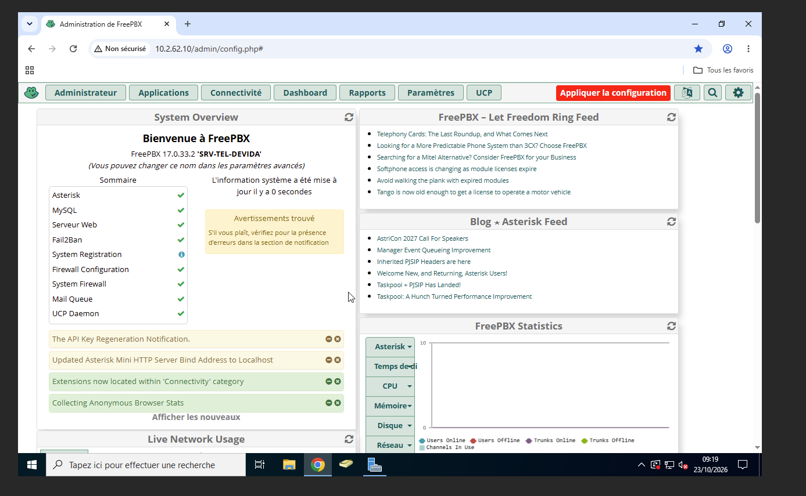

*Figure 248 — Tableau de bord FreePBX après l’installation. Source : `Screenshots/Capture d'écran 2026-10-23 091928.png`.*

> **Comment lire cette capture :** L’ouverture du tableau de bord prouve que l’interface d’administration répond. Il reste ensuite à créer les numéros et à tester un appel.

## 6. Configuration du standard

### 6.1. Paramètres SIP et RTP

Dans **Settings / Paramètres → Asterisk SIP Settings**, déclarer les réseaux locaux `10.2.62.0/24` et `10.2.61.0/24`. Les appels SIP entrants anonymes et les invités restent désactivés dans la configuration photographiée.

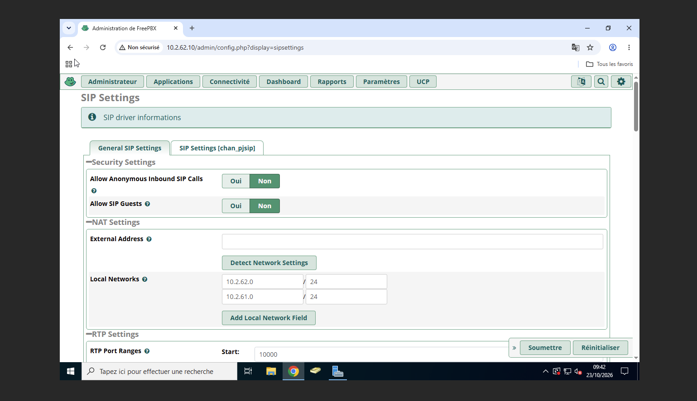

*Figure 259 — Réseaux locaux SIP 10.2.62.0/24 et 10.2.61.0/24 ; appels anonymes et invités désactivés. Source : `Screenshots/Capture d'écran 2026-10-23 094256.png`.*

La plage RTP est définie de `10000` à `20000`. L’onglet `SIP Settings [chan_pjsip]` active le transport UDP et le port d’écoute `5060`.

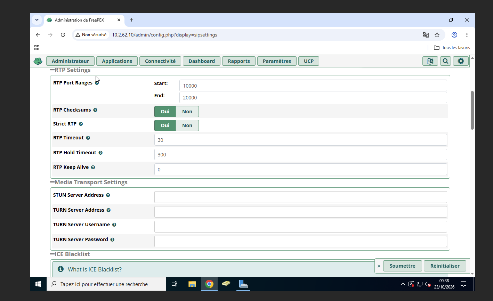

*Figure 255 — Plage RTP de 10000 à 20000 pour les flux audio. Source : `Screenshots/Capture d'écran 2026-10-23 093852.png`.*

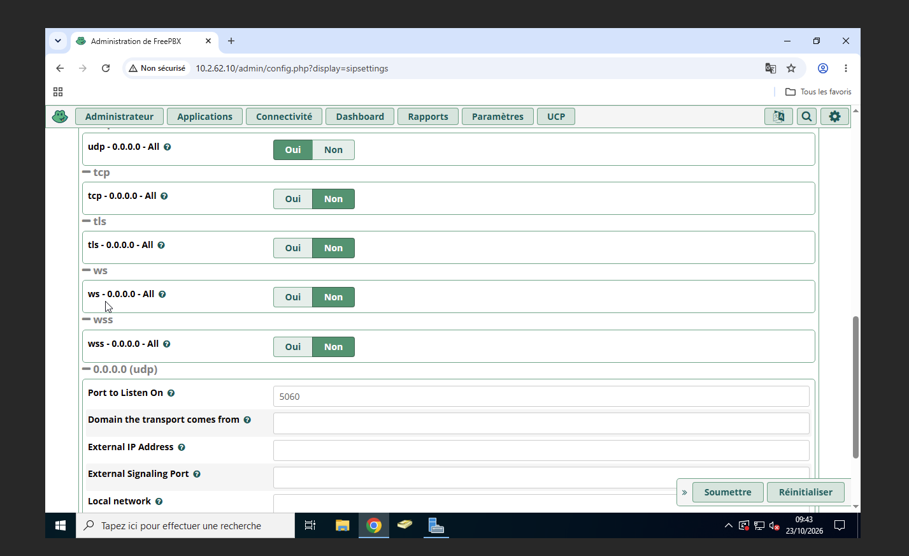

*Figure 262 — Transport PJSIP UDP activé sur le port 5060. Source : `Screenshots/Capture d'écran 2026-10-23 094408.png`.*

Après modification, cliquer sur **Submit / Soumettre**, puis **Apply Config / Appliquer la configuration**. La présence de la bannière Apply Config sur un écran intermédiaire signifie que des changements restent à appliquer ; elle ne doit pas être interprétée comme preuve d’application terminée.

### 6.2. Extensions 201 et 202

Dans le menu **Extensions**, sélectionner **Add Extension → Add New SIP [chan_pjsip] Extension**. Pour chaque poste, renseigner le numéro interne, le nom d’affichage et un secret propre à l’extension, puis enregistrer et appliquer.

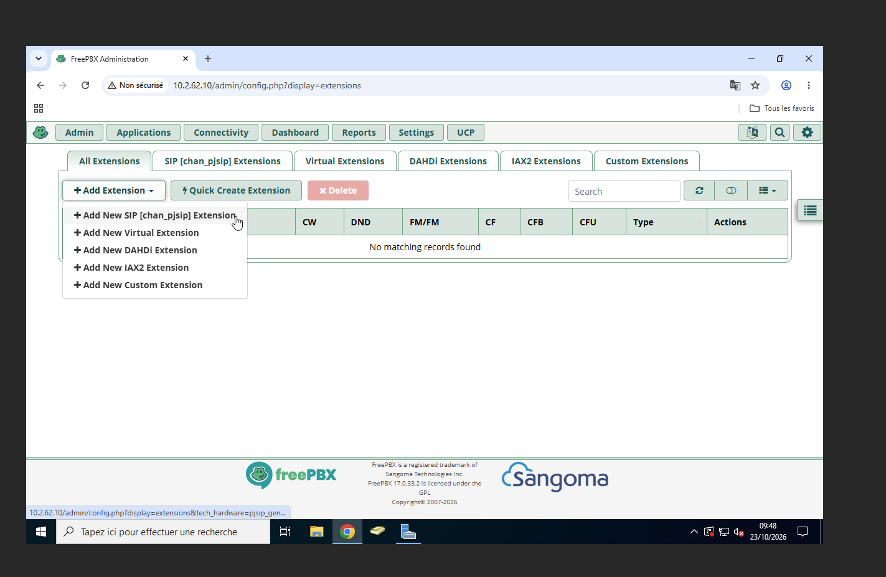

*Figure 265 — Menu de création d’une extension PJSIP. Source : `Screenshots/Capture d'écran 2026-10-23 094910.png`.*

| Extension | Nom affiché dans FreePBX | Identifiant SIP | Secret |
| --- | --- | --- | --- |
| 201 | Post Test A | 201 | Conservé hors du dépôt |
| 202 | Post Test B | 202 | Conservé hors du dépôt |

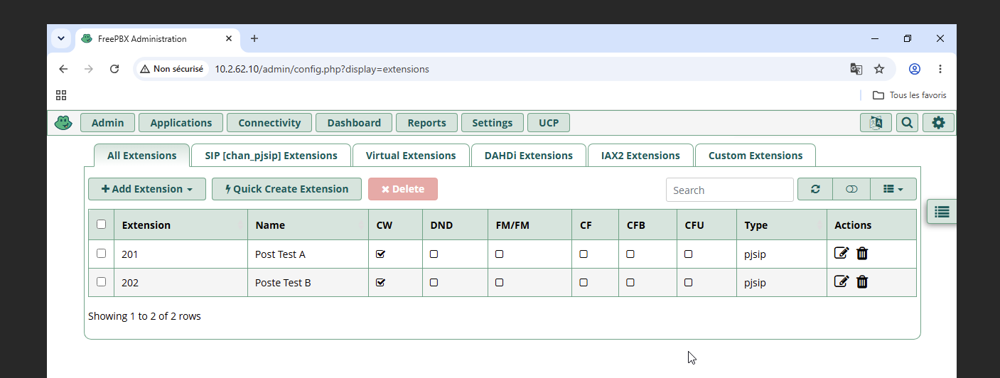

*Figure 271 — Extensions PJSIP 201 et 202 présentes dans FreePBX. Source : `Screenshots/Capture d'écran 2026-10-23 100209.png`.*

> **Comment lire cette capture :** Les deux lignes correspondent aux numéros internes 201 et 202. Leur présence confirme la création des comptes, pas encore la réussite d’une conversation.

Les captures de formulaires montrant les secrets SIP ne sont pas publiées. La liste finale prouve la création des deux extensions sans exposer ces valeurs.

## 7. Clients et validation des appels

### 7.1. Client Windows MicroSIP

Dans MicroSIP, ajouter un compte et saisir :

| Champ | Poste 201 |
| --- | --- |
| Account Name | Poste Test A |
| SIP Server | 10.2.62.10:5060 |
| Username / Login | 201 |
| Domain | 10.2.62.10 |
| Password | Secret SIP de l’extension 201 |
| Transport | UDP |

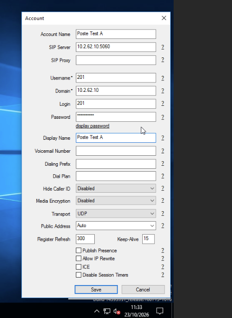

*Figure 282 — Compte MicroSIP du poste 201 ; mot de passe déjà masqué dans la capture originale. Source : `Screenshots/Capture d'écran 2026-10-23 113333.png`.*

Le second client utilise les paramètres du poste 202. Les échanges de réalisation mentionnent un client Android, mais l’archive ne permet pas d’identifier avec certitude son application ni de documenter chaque écran Android. Les réglages SIP sont donc décrits sans inventer le nom du logiciel.

### 7.2. Incident audio

La VM Windows affiche initialement que MicroSIP ne détecte pas de microphone ou de haut-parleur. Un périphérique audio virtuel a été envisagé dans Proxmox.

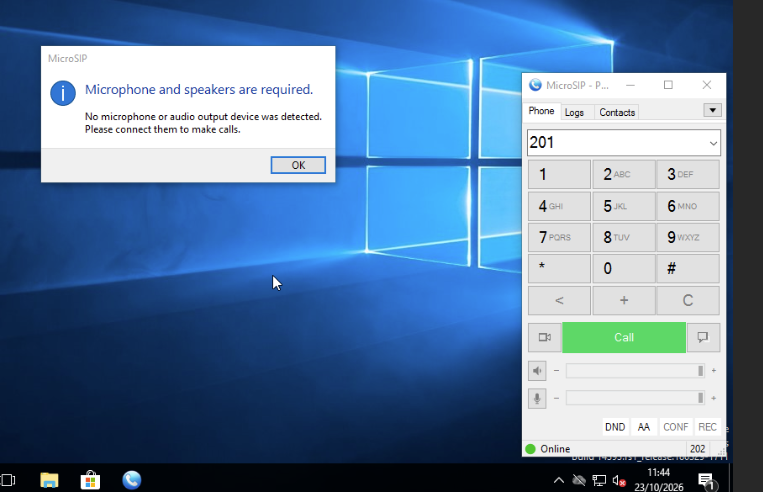

*Figure 284 — Incident : absence de périphérique microphone ou haut-parleur dans la VM Windows. Source : `Screenshots/Capture d'écran 2026-10-23 114442.png`.*

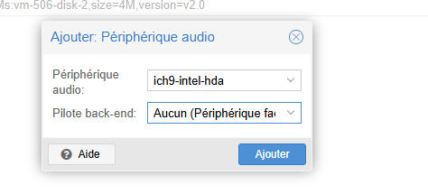

*Figure 287 — Tentative d’ajout d’un périphérique audio virtuel ; ne prouve pas à elle seule un son fonctionnel. Source : `Screenshots/Capture d'écran 2026-10-23 115258.png`.*

Un périphérique virtuel sans sortie audio utilisable ne suffit pas à prouver une conversation audible. La validation doit porter sur les deux extrémités, en vérifiant les périphériques sélectionnés et les flux RTP.

### 7.3. Test d’appel

Depuis le poste 201, composer 202, décrocher sur l’autre client et vérifier les deux sens de conversation. Refaire le test depuis 202 vers 201. La capture disponible montre un appel de 201 vers 202, état `Connected`, avec un compteur de durée.

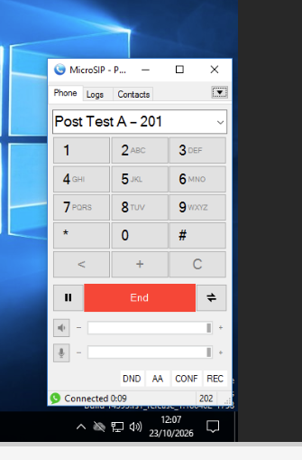

*Figure 288 — Appel MicroSIP de 201 vers 202 affiché Connected. Source : `Screenshots/Capture d'écran 2026-10-23 120732.png`.*

> **Comment lire cette capture :** « Connected » signifie que l’appel a été établi. La capture ne permet pas d’entendre le son : la vérification audio doit être distinguée de cette preuve visuelle.

**Résultat établi :** l’établissement de l’appel est visible. Le fonctionnement audio Windows/Android a été confirmé par l’utilisateur pendant les échanges. La capture seule ne démontre pas la qualité audio ni un test longue durée.

## 8. Sauvegarde

Dans **Admin → Backup & Restore**, créer une tâche de sauvegarde, nommer la tâche et sélectionner les éléments nécessaires. Le module permet ensuite de lancer la sauvegarde et de retrouver l’archive dans le cache local.

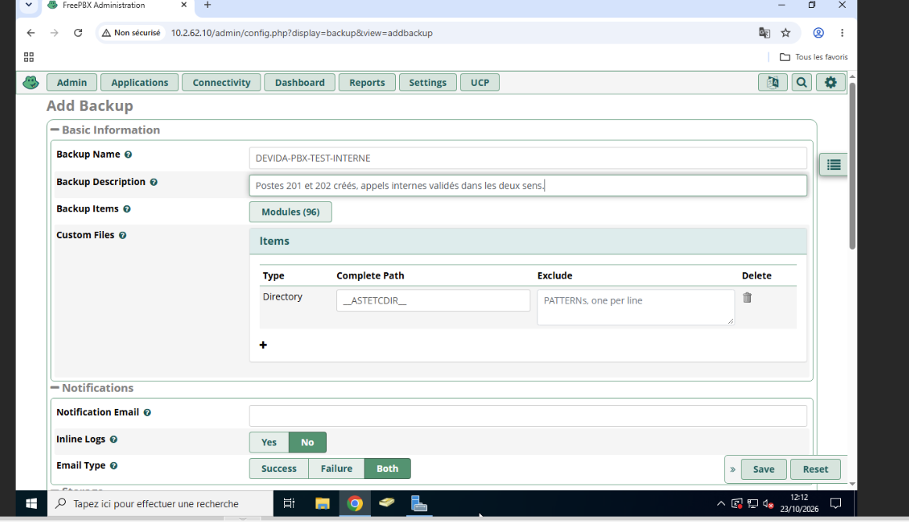

*Figure 290 — Définition d’une tâche de sauvegarde FreePBX. Source : `Screenshots/Capture d'écran 2026-10-23 121230.png`.*

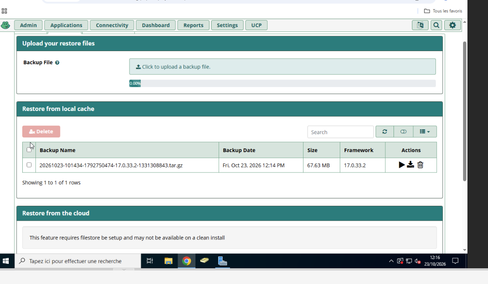

*Figure 295 — Archive de sauvegarde de 67,63 MB présente dans le cache local ; framework 17.0.33.2. Source : `Screenshots/Capture d'écran 2026-10-23 121711.png`.*

> **Comment lire cette capture :** Le fichier et sa taille montrent qu’une archive a été produite. Pour prouver qu’elle permet de récupérer le service, il faudrait aussi réaliser un essai de restauration.

La sauvegarde affichée date du 23 octobre 2026 et pèse 67,63 MB. Le framework indiqué est 17.0.33.2. Une présence dans le cache local n’est pas une sauvegarde externalisée : il reste utile de conserver une copie hors de la VM. Aucun test de restauration n’est démontré dans l’archive.

Les archives FreePBX peuvent contenir des secrets et ne sont pas incluses dans GitHub.

## 9. Accès distant Tailscale

### 9.1. Architecture retenue

Proxmox est utilisé comme routeur de sous-réseaux Tailscale. Les routes approuvées visibles sont `192.168.100.0/24` pour l’administration et `10.2.62.10/32` pour le serveur téléphonique. Cette seconde route vise uniquement le serveur, pas l’ensemble du VLAN voix.

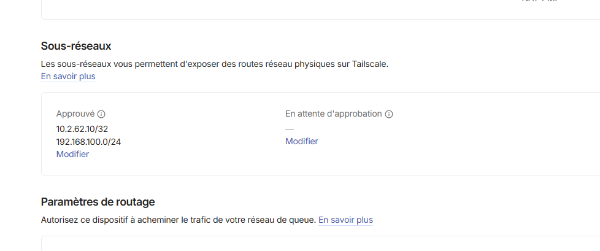

*Figure 308 — Routes Tailscale approuvées vers 10.2.62.10/32 et 192.168.100.0/24. Source : `Screenshots/Capture d'écran 2026-10-29 154720.png`.*

Les commandes exactes d’enrôlement et les paramètres complets du routeur Tailscale ne sont pas visibles dans l’archive. Le rapport conserve la preuve des routes approuvées sans inventer une commande `tailscale up` ou un identifiant d’authentification.

### 9.2. Diagnostic d’un accès HTTP bloqué

Depuis le shell Proxmox, les contrôles observés sont :

<details>
<summary>Voir les commandes ou le détail technique</summary>

```bash
ip route get 10.2.62.10
curl -I --connect-timeout 5 --max-time 10 http://10.2.62.10/admin/
```


</details>
La route est présente, mais la requête HTTP expire. Cela oriente le diagnostic vers le service ou un filtrage, plutôt que vers une absence de route.

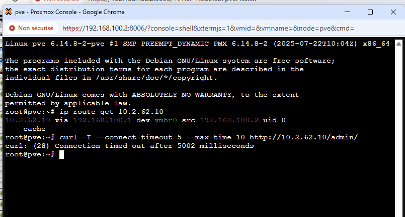

*Figure 301 — Diagnostic depuis Proxmox : route vers FreePBX présente, mais requête HTTP en échec. Source : `Screenshots/Capture d'écran 2026-10-23 125151.png`.*

Dans **Connectivity → Firewall → Networks**, l’adresse `192.168.100.2/32` est ajoutée dans la zone `Local` pour le passage via Proxmox. Les réseaux déjà marqués `Trusted` sont visibles ; ils correspondent à des autorisations larges propres au laboratoire et doivent être revus avant une utilisation en production.

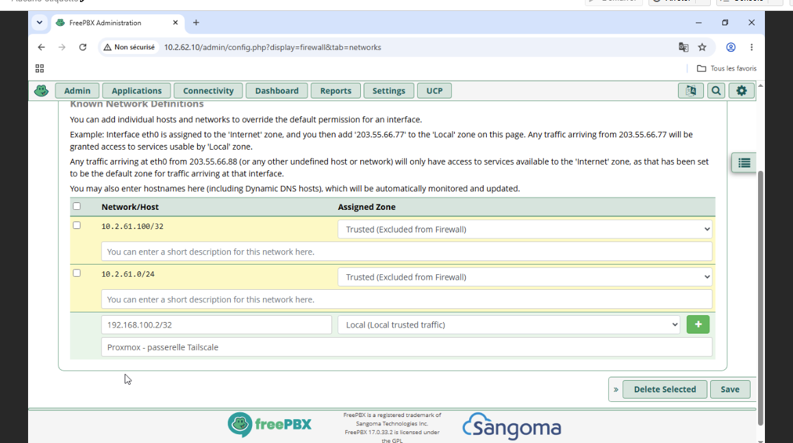

*Figure 305 — Ajout de 192.168.100.2/32 en zone Local du pare-feu FreePBX pour l’accès via Proxmox. Source : `Screenshots/Capture d'écran 2026-10-29 144311.png`.*

Après correction, la requête renvoie `302 Found` vers `config.php`, ce qui confirme que le serveur web répond.

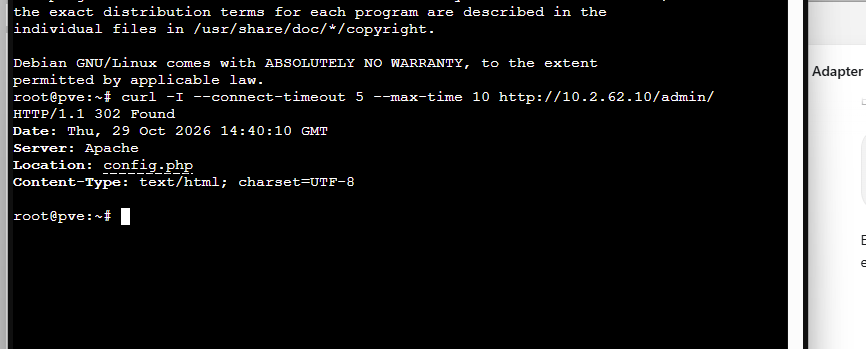

*Figure 306 — Requête HTTP vers FreePBX réussie après correction : réponse 302 vers config.php. Source : `Screenshots/Capture d'écran 2026-10-29 154039.png`.*

> **Comment lire cette capture :** Le code HTTP 302 est une redirection vers une autre page. Dans cet essai, il montre que le serveur web répond de nouveau, même si la page finale demande encore une connexion.

Cette réponse prouve l’accès HTTP depuis Proxmox. Elle ne prouve pas à elle seule un appel audio depuis chaque client Tailscale. Le routage, le filtrage et l’audio doivent être validés séparément.

## 10. Recette, limites et bilan

| Test | Attendu | Résultat et preuve | État |
| --- | --- | --- | --- |
| Réseau Debian | IP et route cohérentes | Figure 216 | Validé |
| Installation FreePBX | Fin sans erreur bloquante | Figure 240 | Validé après dépannage |
| Administration web | Tableau de bord accessible | Figure 248 | Validé |
| Extensions | 201 et 202 présentes | Figure 271 | Validé |
| Appel 201 → 202 | Connexion établie | Figure 288 | Validé |
| Audio dans les deux sens | Conversation audible | Confirmation pendant les échanges, sans preuve audio jointe | Confirmé par l’utilisateur |
| Sauvegarde | Archive créée | Figure 295 | Validé |
| Restauration | Service opérationnel après restauration | Aucune preuve disponible | Non testé / non démontré |
| HTTP depuis Proxmox | Réponse web | Figure 306 | Validé après filtrage |
| Routes Tailscale | Routes approuvées | Figure 308 | Validé côté configuration |

Le résultat répond au besoin de téléphonie interne. Les principales difficultés ont concerné le téléchargement de modules, les périphériques audio de VM et le filtrage de l’accès distant.

Les améliorations à envisager sont une sauvegarde externalisée avec restauration testée, des règles réseau plus ciblées, HTTPS pour l’administration et une revue des possibilités de chiffrement SIP/TLS et SRTP. Ces améliorations ne sont pas présentées comme déployées.

Les compétences mobilisées portent sur la virtualisation, la segmentation réseau, l’installation de services, la gestion des comptes, le diagnostic réseau, la sauvegarde et la rédaction d’une recette. Leur correspondance exacte avec une grille BTS doit être adaptée aux consignes de l’établissement.

## Sources

Les captures et les confirmations du laboratoire constituent les preuves du rapport. La procédure d’installation de référence est vérifiée auprès du [projet officiel FreePBX pour Debian](https://github.com/FreePBX/sng_freepbx_debian_install). Les commandes de diagnostic jointes sont des outils de vérification, pas un export de l’historique complet du serveur.
