# 1 — Déployer Apache Guacamole

[Retour au rapport AP2](README.md) · [Suite : supervision](02-SUPERVISION.md)

## 1.1 Objectif et fonctionnement

Guacamole permet d’ouvrir une session distante depuis un navigateur. L’application web authentifie l’utilisateur et transmet la session à `guacd`, qui dialogue en RDP ou SSH avec la machine cible. PostgreSQL conserve les comptes et les définitions de connexions. Cette architecture à trois composants suit la [documentation Guacamole 1.6.0](https://guacamole.apache.org/doc/1.6.0/gug/guacamole-docker.html).

La connexion au portail avec `guacadmin` et la connexion Windows avec `DEVIDA\nbernard` sont deux authentifications différentes. Les captures ne démontrent pas une authentification LDAP du portail Guacamole.

## 1.2 Création de la VM et installation Debian

Dans Proxmox, la VM **507 / SRV-GUAC-DEVIDA** reçoit deux cœurs, 4 Gio de mémoire, un disque de 32 Go et une carte VirtIO sur `vmbr2`, avec le tag VLAN 500. L’ISO utilisée est Debian 13. L’installation se fait sur le disque de cette nouvelle VM.

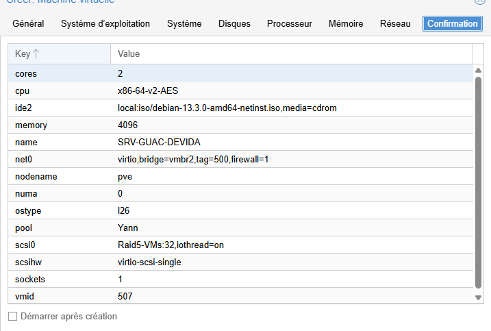

*Figure 318 — Création de la VM Guacamole : Debian 13, 2 cœurs, 4 Go de RAM, 32 Go de disque et VLAN 500. Source : `Screenshots/Capture d'écran 2026-11-13 142117.png`.*

Le nom de machine est `srv-guac-devida`, avec le domaine `DEVIDA.local`. Un compte local `adminlocal` sert à l’administration. Le rôle serveur ne nécessite pas de bureau graphique : seuls SSH et les utilitaires usuels sont retenus.

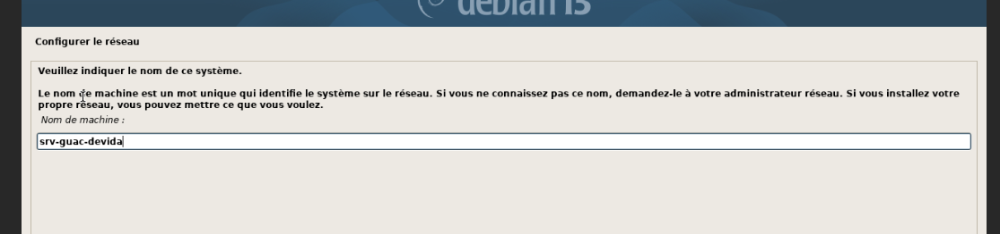

*Figure 321 — Nom d’hôte srv-guac-devida dans l’installation Debian. Source : `Screenshots/Capture d'écran 2026-11-13 142627.png`.*

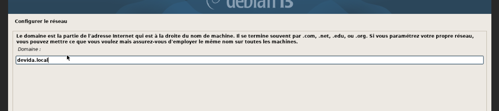

*Figure 322 — Domaine de recherche devida.local dans l’installation Debian. Source : `Screenshots/Capture d'écran 2026-11-13 142700.png`.*

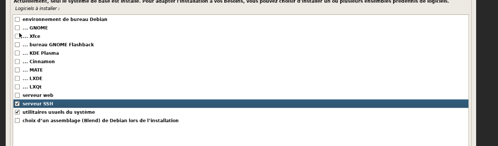

*Figure 328 — Sélection finale d’une installation Guacamole sans bureau graphique, avec SSH. Source : `Screenshots/Capture d'écran 2026-11-13 144302.png`.*

Après installation, la réservation DHCP fixe l’adresse à **10.2.61.121/24**. La passerelle est **10.2.61.1** et les DNS du laboratoire sont **10.2.61.100** et **10.2.61.101**. Le contrôle se fait avec :

```bash
hostname
ip -br a
ip route
cat /etc/resolv.conf
systemctl is-active ssh
```

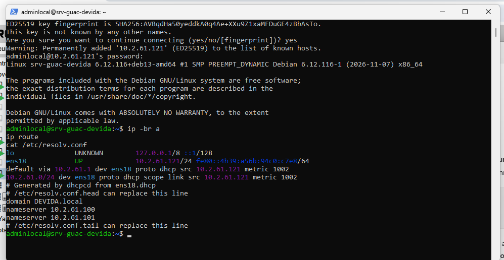

*Figure 332 — Contrôles réseau de Guacamole : adresse, route, DNS et accès SSH. Source : `Screenshots/Capture d'écran 2026-11-13 145211.png`.*

Depuis PowerShell, l’accès d’administration est ouvert avec :

```powershell
ssh adminlocal@10.2.61.121
```

## 1.3 Installer Docker et Compose

Les captures démontrent le fonctionnement de Docker avec `hello-world` et la présence de Docker Compose. Le bloc suivant est une **reconstitution de la procédure officielle pour Debian**, et non la transcription intégrale du terminal d’origine. Il ajoute le dépôt Docker et installe les paquets nécessaires. [Source Docker](https://docs.docker.com/engine/install/debian/).

```bash
sudo apt update
sudo apt install -y ca-certificates curl
sudo install -m 0755 -d /etc/apt/keyrings
sudo curl -fsSL https://download.docker.com/linux/debian/gpg -o /etc/apt/keyrings/docker.asc
sudo chmod a+r /etc/apt/keyrings/docker.asc
sudo tee /etc/apt/sources.list.d/docker.sources >/dev/null <<EOF
Types: deb
URIs: https://download.docker.com/linux/debian
Suites: $(. /etc/os-release && echo "$VERSION_CODENAME")
Components: stable
Architectures: $(dpkg --print-architecture)
Signed-By: /etc/apt/keyrings/docker.asc
EOF
sudo apt update
sudo apt install -y docker-ce docker-ce-cli containerd.io docker-buildx-plugin docker-compose-plugin
sudo docker run hello-world
sudo docker compose version
```

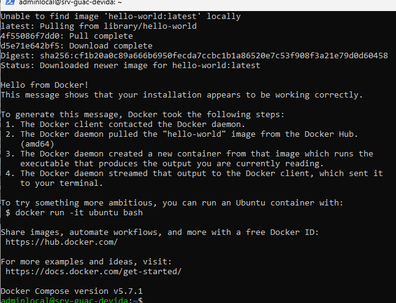

*Figure 336 — Test Docker hello-world réussi et version de Docker Compose affichée. Source : `Screenshots/Capture d'écran 2026-11-13 155045.png`.*

## 1.4 Préparer PostgreSQL et les secrets

Le dossier de travail est `~/guacamole`. Le schéma PostgreSQL est généré depuis l’image de la même version que l’application :

```bash
mkdir -p ~/guacamole/init
cd ~/guacamole
sudo docker run --rm guacamole/guacamole:1.6.0 \
  /opt/guacamole/bin/initdb.sh --postgresql > init/001-guacamole.sql
wc -l init/001-guacamole.sql
```

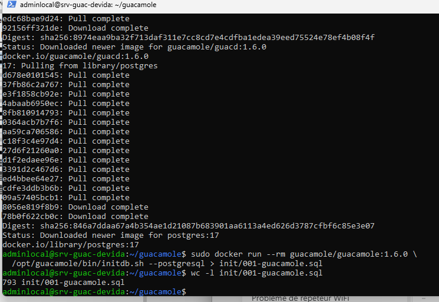

*Figure 337 — Téléchargement des images et génération du schéma PostgreSQL Guacamole. Source : `Screenshots/Capture d'écran 2026-11-13 155348.png`.*

Un fichier `.env` local contient le mot de passe de la base. Il n’est pas ajouté au dépôt. La commande observée utilise `umask 077` pour limiter sa lecture et ne remplace pas un secret déjà présent :

```bash
(
  umask 077
  if [ ! -e .env ]; then
    printf 'DB_PASSWORD=%s\n' "$(od -An -N32 -tx1 /dev/urandom | tr -d ' \n')" > .env
  fi
)
```

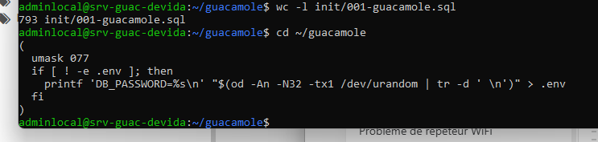

*Figure 338 — Génération locale d’un secret de base de données dans .env ; valeur non affichée. Source : `Screenshots/Capture d'écran 2026-11-13 155733.png`.*

Le script SQL placé dans `docker-entrypoint-initdb.d` est utilisé lors de la première initialisation d’une base vide. Il ne faut pas supprimer le volume PostgreSQL pour résoudre un simple problème d’accès web : il contient les données du portail.

## 1.5 Définir et démarrer les conteneurs

Le fichier [compose.yaml](configurations/compose.yaml) restitue les paramètres connus : images 1.6.0, base `guacamole_db`, utilisateur `guacamole_user`, volume persistant et publication de `10.2.61.121:8080`. Les variables PostgreSQL suivent les noms documentés pour cette version, dont `POSTGRESQL_USERNAME`. [Référence de l’authentification PostgreSQL](https://guacamole.apache.org/doc/1.6.0/gug/postgresql-auth.html).

Enregistrer ce fichier dans `~/guacamole/compose.yaml`, puis contrôler sa syntaxe sans afficher le secret :

```bash
cd ~/guacamole
sudo docker compose config --quiet
sudo docker compose up -d
sudo docker compose ps -a
sudo docker compose logs --tail=50 guacamole
```

Le test de santé de PostgreSQL permet d’attendre que la base réponde avant le lancement de l’application. Seul le port web est publié sur l’hôte ; la base et `guacd` communiquent sur le réseau interne Compose.

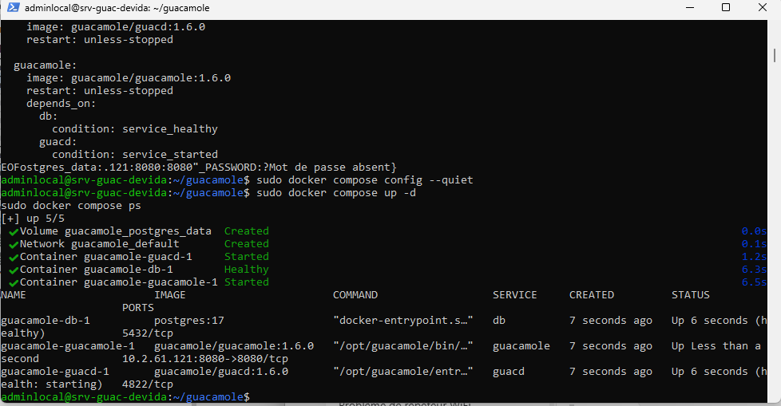

*Figure 340 — Démarrage des trois conteneurs et publication de 10.2.61.121:8080. Source : `Screenshots/Capture d'écran 2026-11-13 160103.png`.*

Dans le navigateur, ouvrir **http://10.2.61.121:8080/guacamole/**. Le compte initial est remplacé ou sécurisé lors de la configuration ; aucun mot de passe de connexion n’est conservé dans le rapport.

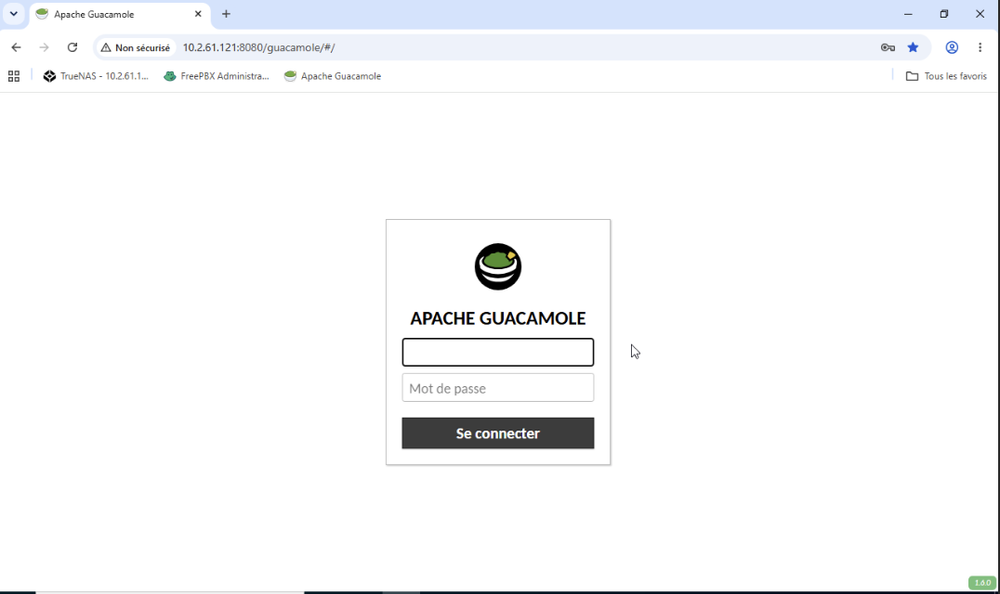

*Figure 342 — Page d’authentification Apache Guacamole accessible. Source : `Screenshots/Capture d'écran 2026-11-13 161407.png`.*

## 1.6 Créer la connexion RDP

La connexion **USER-AD-DEVIDA** vise le poste Windows **10.2.61.126**, et non le contrôleur de domaine. Paramètres retenus :

| Champ | Valeur |
| --- | --- |
| Protocole | RDP |
| Hôte / port | 10.2.61.126 / 3389 |
| Identifiant | nbernard |
| Domaine | DEVIDA.local |
| Sécurité | NLA |
| Disposition clavier | Français AZERTY |
| Mot de passe | Secret du compte Windows, saisi localement |

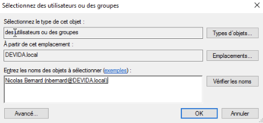

*Figure 347 — Sélection d’un utilisateur du domaine pour l’accès Bureau à distance. Source : `Screenshots/Capture d'écran 2026-11-13 163445.png`.*

La figure suivante montre une étape de saisie du formulaire ; tous ses champs ne sont pas encore renseignés.

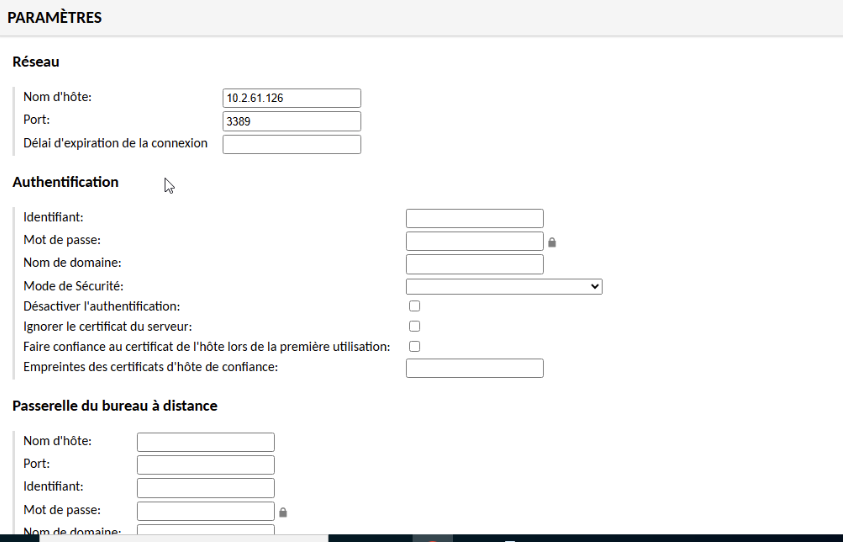

*Figure 350 — Début du paramétrage RDP : cible 10.2.61.126, port 3389 ; formulaire encore incomplet. Source : `Screenshots/Capture d'écran 2026-11-13 163848.png`.*

Une première tentative affiche une erreur de permissions dans le navigateur. L’examen des journaux `guacd` précise **Credentials expired** : le serveur RDP refuse les identifiants expirés. Le diagnostic porte donc sur le compte Windows et son mot de passe, pas seulement sur les autorisations du portail.

```bash
cd ~/guacamole
sudo docker compose logs --since=5m --tail=80 guacd guacamole
```

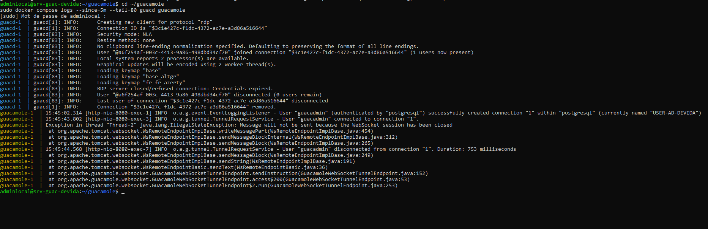

*Figure 359 — Journal guacd indiquant Credentials expired lors de l’échec RDP. Source : `Screenshots/Capture d'écran 2026-11-13 164706.png`.*

Après régularisation du compte, les captures montrent le bureau distant. `ipconfig` confirme l’adresse du poste et `whoami` l’identité de domaine. La méthode exacte de changement de mot de passe n’étant pas conservée dans les preuves, aucune commande de réinitialisation n’est inventée ici.

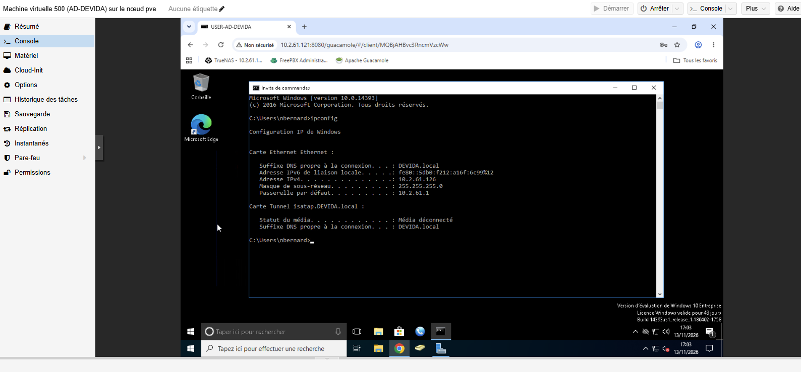

*Figure 360 — Session Windows affichée dans Guacamole ; ipconfig identifie la cible 10.2.61.126. Source : `Screenshots/Capture d'écran 2026-11-13 170327.png`.*

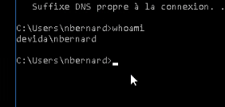

*Figure 361 — whoami confirme une session ouverte avec le compte de domaine devida\nbernard. Source : `Screenshots/Capture d'écran 2026-11-13 170435.png`.*

## 1.7 Créer la connexion SSH

La connexion **SSH-SRV-GUAC-DEVIDA** utilise SSH vers **10.2.61.121:22**, avec le compte local `adminlocal`. Le mot de passe est saisi dans l’interface sans être reproduit dans le rapport.

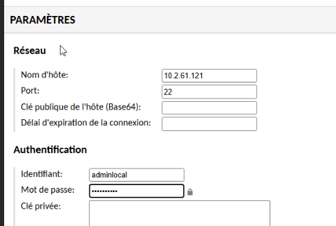

*Figure 363 — Paramètres SSH vers 10.2.61.121:22 avec adminlocal et mot de passe masqué. Source : `Screenshots/Capture d'écran 2026-11-13 170859.png`.*

Dans le terminal ouvert depuis Guacamole, les commandes `whoami` et `hostname` identifient la session. Elles retournent respectivement `adminlocal` et `srv-guac-devida`.

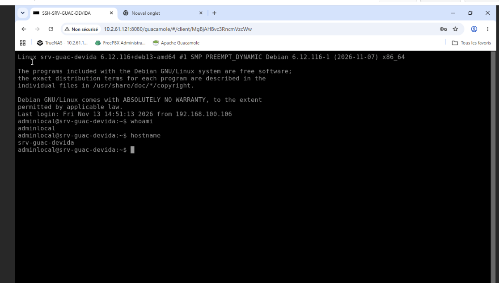

*Figure 365 — Session SSH Guacamole fonctionnelle : whoami et hostname. Source : `Screenshots/Capture d'écran 2026-11-13 171059.png`.*

## 1.8 Incident : interface web inaccessible après redémarrage

Le 26 novembre, le portail n’est plus accessible. Docker fonctionne, mais le conteneur web est à l’état **Exited (143)** tandis que PostgreSQL et `guacd` sont actifs. Cette observation ne permet pas de déterminer qui ou quoi a arrêté le conteneur.

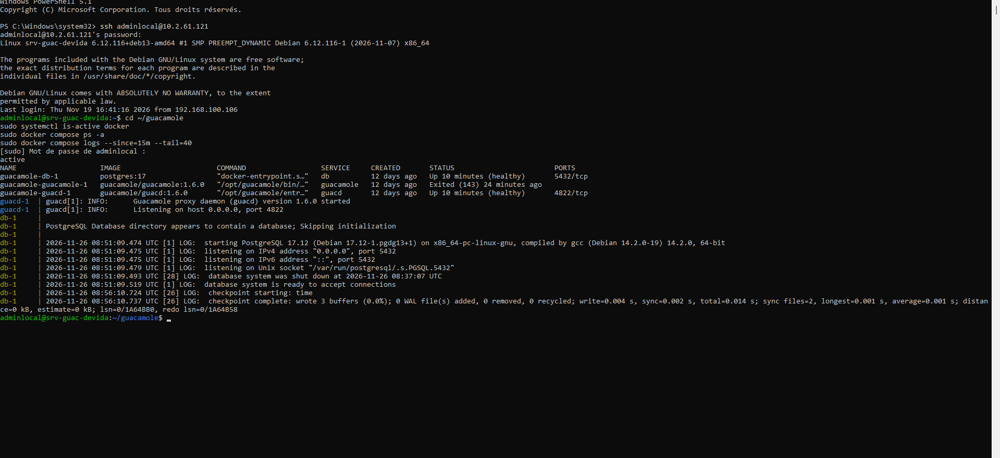

*Figure 400 — Incident Guacamole : Docker actif, base et guacd disponibles, conteneur web arrêté. Source : `Screenshots/Capture d'écran 2026-11-26 100239.png`.*

Le démarrage du seul service web remet le processus en marche, mais ne suffit pas à rendre le port accessible. Les contrôles suivants montrent l’absence de port publié et un refus de connexion :

```bash
sudo docker compose start guacamole
sudo docker compose port guacamole 8080
curl -I --connect-timeout 5 --max-time 10 http://10.2.61.121:8080/guacamole/
```

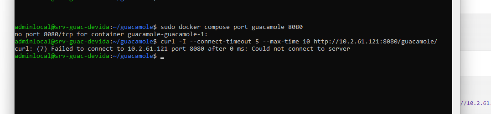

*Figure 402 — Absence de publication effective du port 8080 et refus de connexion HTTP. Source : `Screenshots/Capture d'écran 2026-11-26 100451.png`.*

La configuration déclarative contient pourtant le port hôte `8080` sur `10.2.61.121`. Il existe donc un écart entre la définition Compose et l’état du conteneur en cours.

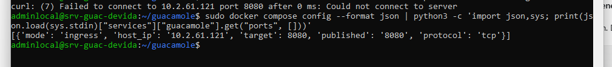

*Figure 403 — Configuration Compose déclarant pourtant la publication du port 8080. Source : `Screenshots/Capture d'écran 2026-11-26 100550.png`.*

La remise en conformité consiste à recréer seulement le service web à partir du fichier Compose, en conservant la base :

```bash
cd ~/guacamole
sudo docker compose up -d --no-deps --force-recreate guacamole
sudo docker compose ps -a
sudo docker compose port guacamole 8080
```

La réapparition de l’écran de connexion constitue la preuve de retour du service web.

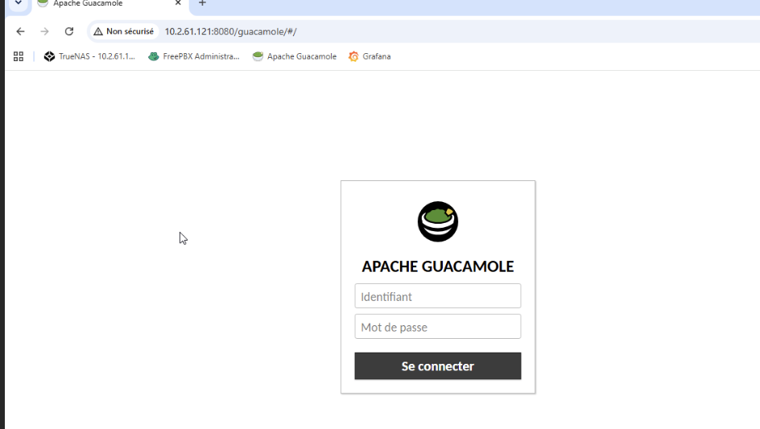

*Figure 404 — Page Guacamole de nouveau accessible après la correction. Source : `Screenshots/Capture d'écran 2026-11-26 100721.png`.*

## 1.9 Recette et limites

| Test | Résultat établi |
| --- | --- |
| Docker démarre un conteneur de test | Message hello-world |
| PostgreSQL et guacd démarrent | États healthy visibles |
| Portail web | Écran de connexion affiché |
| Session RDP | Bureau Windows, IP et identité de domaine contrôlés |
| Session SSH | Identité et nom du serveur contrôlés |
| Correction du port web | Portail de nouveau accessible |
| Sauvegarde/restauration de PostgreSQL | Non démontrée ; le volume persistant ne constitue pas une sauvegarde |

L’accès HTTP du laboratoire fonctionne, mais le HTTPS reste à mettre en place pour un usage durable. Une session RDP réussie ne prouve pas l’accès de tous les utilisateurs : les droits et les identifiants doivent être gérés par connexion et par compte.
