# 2 — Installer la supervision et construire les tableaux de bord

[Rapport AP2](README.md) · [Précédent : Guacamole](01-GUACAMOLE.md) · [Suite : alertes](03-ALERTES.md)

## 2.1 Préparer le serveur de supervision

La VM **508 / SRV-SUPERVISION-DEVIDA** est dédiée à la supervision : deux cœurs, environ 4 Gio de RAM, un disque de 32 Go, Debian 13 et une carte VirtIO sur `vmbr2`, VLAN 500. Le serveur fonctionne sans bureau graphique. Grafana est consulté dans le navigateur du poste d’administration.

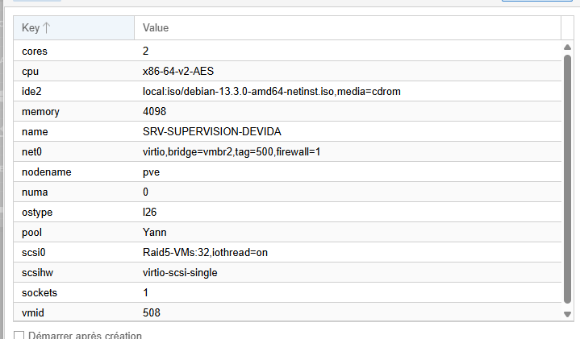

*Figure 366 — Création de SRV-SUPERVISION-DEVIDA, VM 508 : 2 cœurs, environ 4 Go de RAM, disque 32 Go. Source : `Screenshots/Capture d'écran 2026-11-19 113922.png`.*

L’adresse **10.2.61.123/24** est attribuée par DHCP puis réservée. La passerelle est **10.2.61.1** ; les DNS sont **10.2.61.100** et **10.2.61.101**. SSH est actif.

```bash
ip -br a
ip route
cat /etc/resolv.conf
systemctl is-active ssh
```

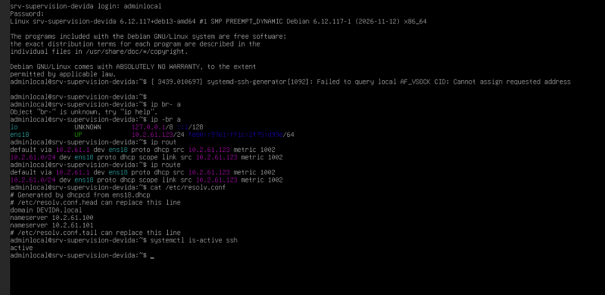

*Figure 376 — Adresse 10.2.61.123/24, passerelle, DNS et service SSH actif sur le serveur de supervision. Source : `Screenshots/Capture d'écran 2026-11-19 145431.png`.*

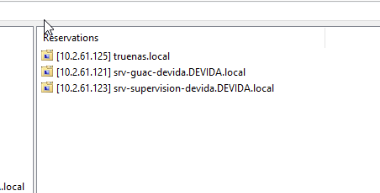

*Figure 378 — Réservations DHCP de Guacamole, TrueNAS et du serveur de supervision. Source : `Screenshots/Capture d'écran 2026-11-19 145910.png`.*

L’administration depuis Windows se fait avec `ssh adminlocal@10.2.61.123`. La réservation stabilise les adresses utilisées dans les cibles Prometheus et les règles de pare-feu.

## 2.2 Installer Prometheus et Node Exporter

La procédure remise au propre utilise les paquets Debian :

```bash
sudo apt update
sudo apt install -y prometheus prometheus-node-exporter
sudo systemctl enable --now prometheus prometheus-node-exporter
systemctl is-active prometheus prometheus-node-exporter
```

Prometheus collecte et conserve les séries temporelles. Node Exporter expose les métriques Linux sur le port **9100**. Le résultat observé indique que les deux services sont `active`.

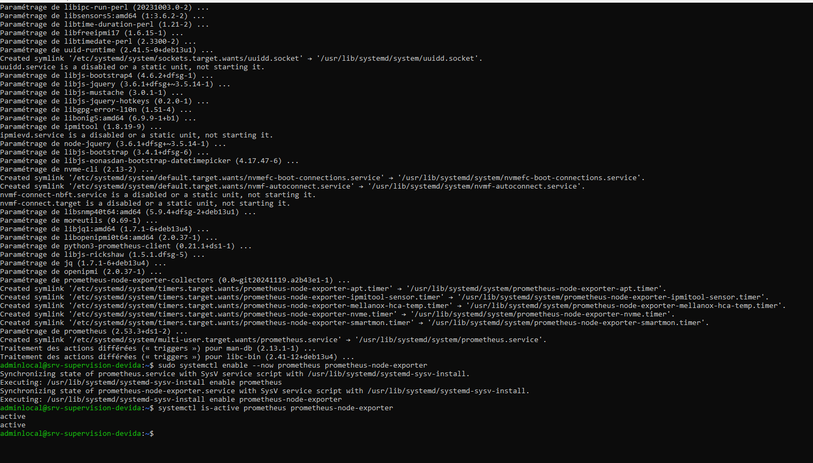

*Figure 379 — Installation de Prometheus et Node Exporter ; les deux services sont actifs. Source : `Screenshots/Capture d'écran 2026-11-19 150423.png`.*

Le fichier principal est `/etc/prometheus/prometheus.yml`. Le [fichier fourni](configurations/prometheus.yml) regroupe les cibles finales connues. Il conserve l’intervalle global de collecte à **15 secondes** et le contrôle de Prometheus lui-même à **5 secondes**. La section Alertmanager préremplie dans le fichier Debian n’est pas nécessaire ici : les notifications du projet sont gérées par Grafana, et aucune installation indépendante d’Alertmanager n’est démontrée.

Le paquet Debian présente une page d’accueil expliquant l’absence de l’interface React. L’interface classique suffit pour contrôler les cibles : **http://10.2.61.123:9090/classic/targets**. Ce choix n’empêche pas Grafana d’utiliser l’API Prometheus.

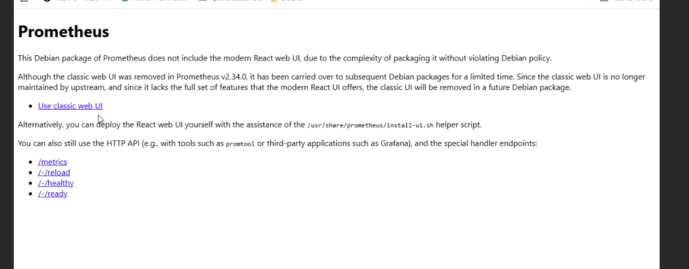

*Figure 388 — Paquet Debian Prometheus : accès proposé à l’interface classique. Source : `Screenshots/Capture d'écran 2026-11-19 161514.png`.*

## 2.3 Installer Grafana

Les captures montrent Grafana **13.3.1**. Le bloc suivant reconstitue l’installation par le dépôt APT officiel ; la version obtenue dépendra de la date d’exécution. [Documentation Grafana pour Debian](https://grafana.com/docs/grafana/latest/setup-grafana/installation/debian/).

```bash
sudo apt install -y apt-transport-https wget gnupg
sudo mkdir -p /etc/apt/keyrings
sudo wget -O /etc/apt/keyrings/grafana.asc https://apt.grafana.com/gpg-full.key
sudo chmod 644 /etc/apt/keyrings/grafana.asc
echo 'deb [signed-by=/etc/apt/keyrings/grafana.asc] https://apt.grafana.com stable main' | sudo tee /etc/apt/sources.list.d/grafana.list
sudo apt update
sudo apt install -y grafana
sudo systemctl enable --now grafana-server
systemctl is-active grafana-server
```

L’interface est accessible à **http://10.2.61.123:3000**. Après la première connexion, définir un mot de passe propre au compte administrateur.

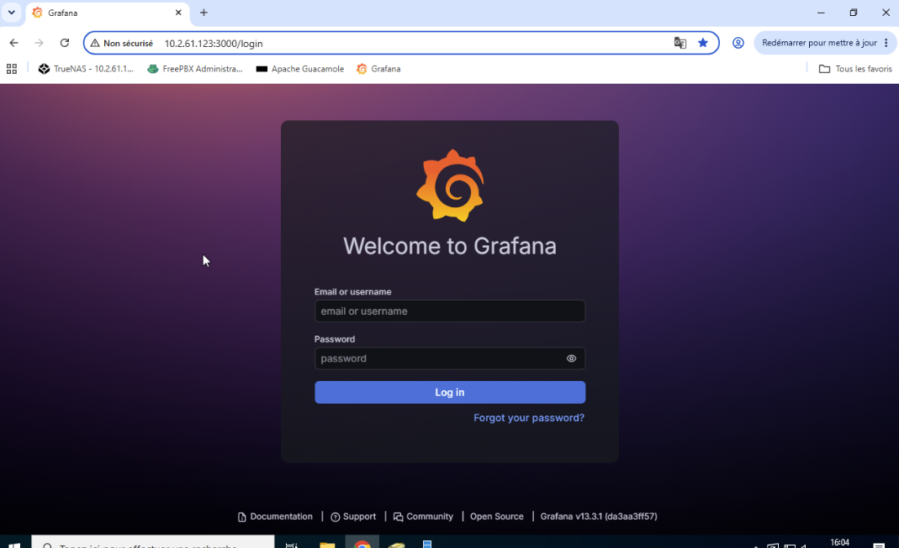

*Figure 380 — Page de connexion Grafana ; version OSS 13.3.1 visible. Source : `Screenshots/Capture d'écran 2026-11-19 160521.png`.*

## 2.4 Relier Grafana à Prometheus

Dans **Connexions → Sources de données**, ajouter une source **Prometheus** nommée `prometheus`. Renseigner `http://localhost:9090`, sans authentification dans ce laboratoire. Ici, `localhost` désigne le serveur Grafana, où Prometheus est également installé ; ce n’est pas le PC qui affiche le navigateur.

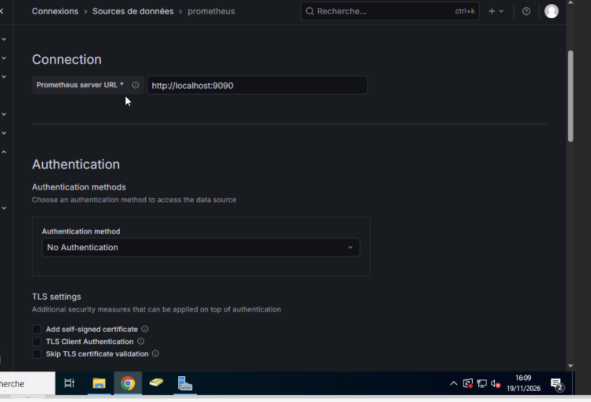

*Figure 384 — Source Prometheus dans Grafana : URL locale http://localhost:9090. Source : `Screenshots/Capture d'écran 2026-11-19 161006.png`.*

Cliquer sur **Save & test / Enregistrer et tester**. Le message **Successfully queried the Prometheus API** valide la communication entre les deux logiciels.

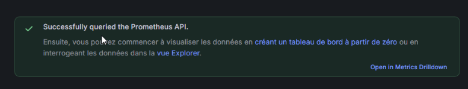

*Figure 385 — Test réussi de la source de données Prometheus depuis Grafana. Source : `Screenshots/Capture d'écran 2026-11-19 161059.png`.*

Dans **Explorer**, sélectionner cette source puis exécuter :

```promql
up
```

Une valeur `1` signifie que Prometheus a pu collecter la cible correspondante lors de son dernier passage. Cette valeur ne garantit pas que toutes les fonctions de l’application surveillée sont disponibles.

## 2.5 Superviser les deux serveurs Linux

Sur **SRV-GUAC-DEVIDA / 10.2.61.121**, installer uniquement l’agent :

```bash
sudo apt update
sudo apt install -y prometheus-node-exporter
sudo systemctl enable --now prometheus-node-exporter
systemctl is-active prometheus-node-exporter
```

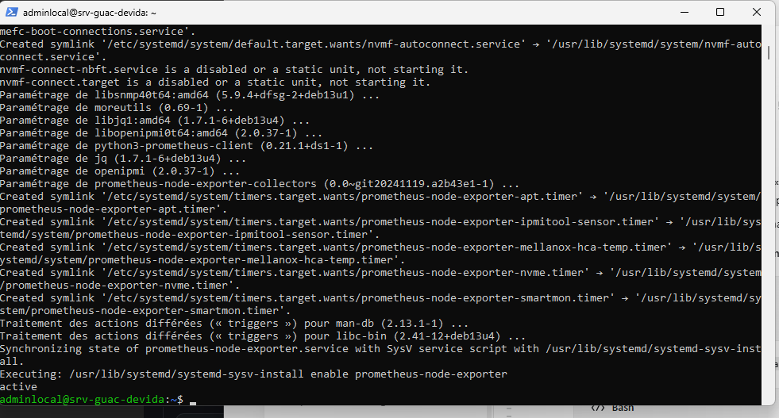

*Figure 394 — Node Exporter actif sur le serveur Guacamole. Source : `Screenshots/Capture d'écran 2026-11-19 164348.png`.*

Depuis le serveur de supervision, vérifier que les métriques sont accessibles :

```bash
wget --timeout=5 -O /dev/null http://10.2.61.121:9100/metrics
```

Dans le job `node` de Prometheus, conserver les deux cibles :

```yaml
  - job_name: node
    static_configs:
      - targets: ['localhost:9100', '10.2.61.121:9100']
```

Après toute modification, vérifier la configuration avant de redémarrer :

```bash
sudo promtool check config /etc/prometheus/prometheus.yml && sudo systemctl restart prometheus
```

La page Targets affiche **node (2/2 up)** et **prometheus (1/1 up)**.

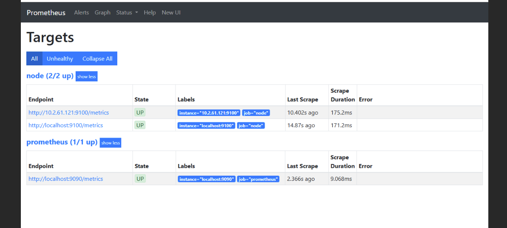

*Figure 396 — Deux cibles Linux et la cible Prometheus affichées UP. Source : `Screenshots/Capture d'écran 2026-11-19 170215.png`.*

Importer le tableau **Node Exporter Full** depuis Grafana.com, identifiant **1860**, puis choisir la source `prometheus`. Le menu **Job** doit être `node`. Le nom et l’instance permettent de passer de la supervision à Guacamole.

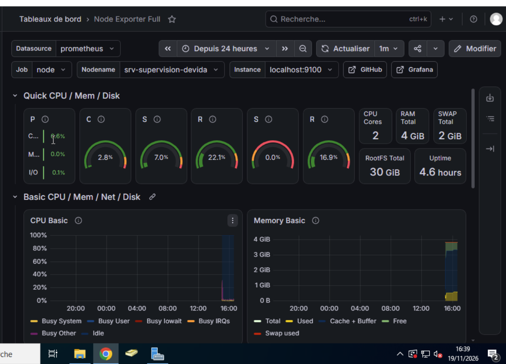

*Figure 393 — Tableau Node Exporter Full du serveur de supervision. Source : `Screenshots/Capture d'écran 2026-11-19 163930.png`.*

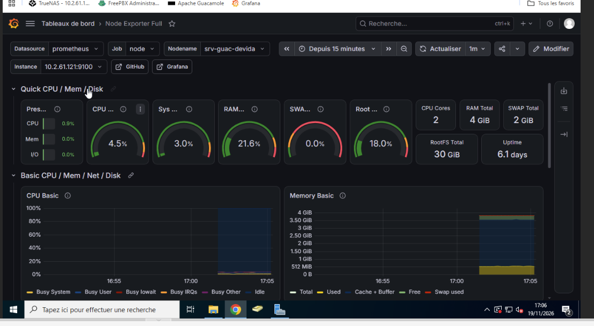

*Figure 397 — Tableau Node Exporter Full affichant les mesures de srv-guac-devida. Source : `Screenshots/Capture d'écran 2026-11-19 170627.png`.*

Les panneaux montrent le CPU, la mémoire, le disque, le réseau et la durée de fonctionnement. Au début, l’historique est court : réduire la période affichée à 15 ou 30 minutes rend les premières mesures plus lisibles. Un rafraîchissement de 15 ou 30 secondes est adapté à une collecte toutes les 15 secondes ; il ne crée pas de mesures supplémentaires.

## 2.6 Installer Windows Exporter sur l’AD

Avant de choisir l’agent, le système est identifié depuis PowerShell :

```powershell
Get-CimInstance Win32_OperatingSystem | Select-Object Caption, Version, OSArchitecture
```

La capture indique **Windows Server 2022 Standard Evaluation**, version **10.0.20348**, 64 bits.

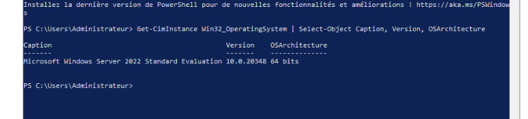

*Figure 405 — Identification de Windows Server 2022 Standard Evaluation, version 10.0.20348, 64 bits. Source : `Screenshots/Capture d'écran 2026-11-26 101358.png`.*

Le MSI **windows_exporter 0.32.1 amd64** est installé depuis une console PowerShell administrateur. La commande demande les collecteurs par défaut ainsi que `ad`, `dns` et `dhcp`. L’exception de pare-feu est limitée à **10.2.61.123**, le serveur de supervision. Le [script fourni](configurations/install-windows-exporter.ps1) reprend les paramètres observés avec un contrôle explicite du résultat. [Documentation de la version 0.32.1](https://github.com/prometheus-community/windows_exporter/blob/v0.32.1/README.md).

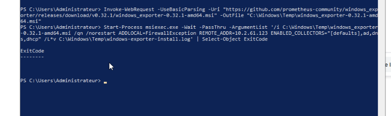

*Figure 406 — Installation de Windows Exporter 0.32.1 avec restriction réseau à 10.2.61.123. Source : `Screenshots/Capture d'écran 2026-11-26 101808.png`.*

Contrôles effectués après installation :

```powershell
Get-Service windows_exporter
(Invoke-WebRequest -UseBasicParsing -Uri 'http://localhost:9182/health').StatusCode
```

Le service est **Running** et le point de contrôle répond **200**. L’affichage du code de sortie MSI dans la capture précédente est vide ; la validation repose donc sur ces contrôles et sur la collecte réussie.

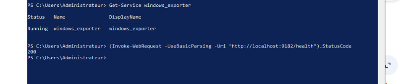

*Figure 407 — Service windows_exporter Running et contrôle HTTP local réussi, code 200. Source : `Screenshots/Capture d'écran 2026-11-26 101911.png`.*

## 2.7 Ajouter la cible Windows

Sur le serveur de supervision, ajouter le job suivant au même niveau d’indentation que `node` et `prometheus` :

```yaml
  - job_name: windows
    static_configs:
      - targets: ['10.2.61.100:9182']
```

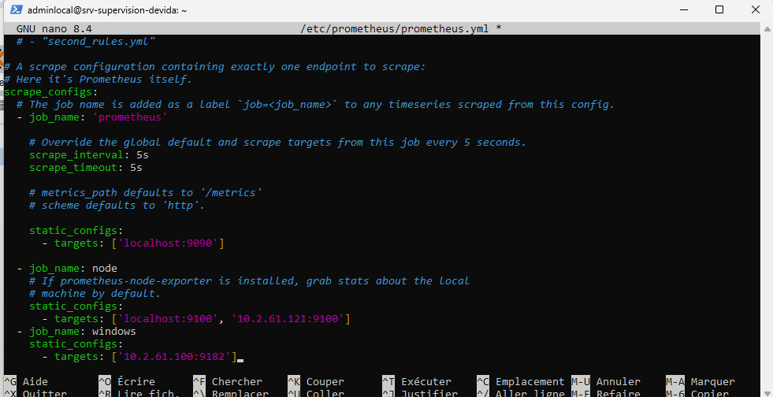

*Figure 410 — Ajout du job windows et de la cible 10.2.61.100:9182 à Prometheus. Source : `Screenshots/Capture d'écran 2026-11-26 102345.png`.*

Valider avec `promtool`, redémarrer Prometheus puis consulter Targets. La cible **windows (1/1 up)** confirme que la collecte traverse le réseau et le pare-feu.

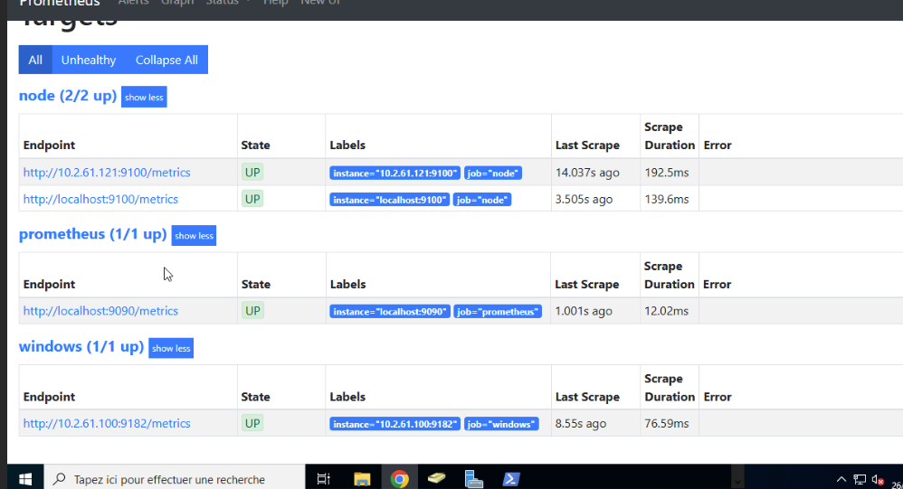

*Figure 411 — Cible Windows, deux cibles Linux et Prometheus toutes UP. Source : `Screenshots/Capture d'écran 2026-11-26 102620.png`.*

## 2.8 Importer et adapter le tableau Windows

Importer **Windows Exporter Dashboard 2025 (v0.31+ compatible)**, identifiant **23942**, puis affecter `prometheus` au champ `DS_PROMETHEUS`. Choisir le job `windows` et l’instance `10.2.61.100:9182`.

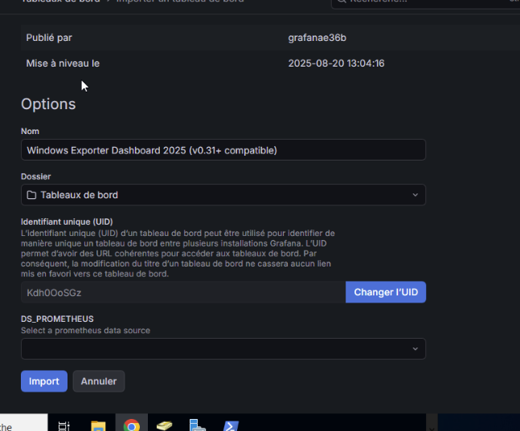

*Figure 412 — Import du tableau Windows Exporter compatible avec les versions 0.31 et suivantes. Source : `Screenshots/Capture d'écran 2026-11-26 102824.png`.*

Certains panneaux ne produisaient pas immédiatement de données. Le CPU a été contrôlé dans Explorer avec la requête suivante, puis le panneau a été adapté :

```promql
100 - (
  avg by (instance) (
    rate(windows_cpu_time_seconds_total{instance="10.2.61.100:9182",mode="idle"}[5m])
  ) * 100
)
```

La requête calcule le pourcentage occupé à partir du temps inactif moyen des processeurs. La fenêtre de cinq minutes lisse la mesure. Les métriques sont documentées dans le [collecteur CPU de Windows Exporter](https://github.com/prometheus-community/windows_exporter/blob/v0.32.1/docs/collector.cpu.md).

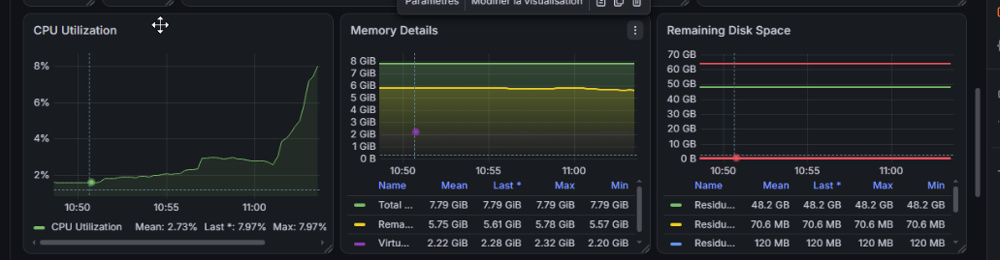

*Figure 417 — Graphiques CPU, mémoire et espace disque Windows après correction du panneau CPU. Source : `Screenshots/Capture d'écran 2026-11-26 110800.png`.*

Ne pas interpréter « No data » comme une panne CPU : cela peut venir d’une requête, d’un filtre, d’une fenêtre trop courte ou d’un collecteur absent. L’exécution dans Explorer permet de séparer ces causes.

## 2.9 Vérifier la page web Guacamole avec Blackbox Exporter

Node Exporter surveille Linux ; il ne teste pas l’interface Guacamole. Blackbox Exporter est ajouté sur la VM de supervision :

```bash
sudo apt install -y prometheus-blackbox-exporter
sudo systemctl enable --now prometheus-blackbox-exporter
systemctl is-active prometheus-blackbox-exporter
```

Le module `http_2xx` est présent dans la configuration Debian observée. L’[exemple minimal fourni](configurations/blackbox.yml) conserve le contrôle HTTP et la préférence IPv4. Il ne faut pas écraser les autres modules d’un fichier déjà utilisé.

Test direct observé :

```bash
wget -qO- --timeout=15 'http://localhost:9115/probe?target=http://10.2.61.121:8080/guacamole/&module=http_2xx' | grep -E '^probe_(success|http_status_code|duration_seconds) '
```

La réponse contient `probe_http_status_code 200`, `probe_success 1` et une durée d’environ **0,013 seconde** pour ce test.

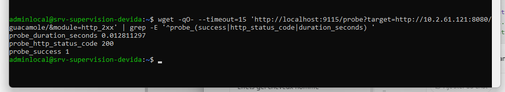

*Figure 419 — Sonde Blackbox de Guacamole : HTTP 200 et probe_success égal à 1. Source : `Screenshots/Capture d'écran 2026-11-26 111143.png`.*

Le job `guacamole_web` du [fichier Prometheus](configurations/prometheus.yml) transmet l’URL à Blackbox par `__param_target`, conserve cette URL comme étiquette `instance`, puis dirige la collecte vers `localhost:9115`. Ce mécanisme correspond au [modèle multi-cibles de Prometheus](https://prometheus.io/docs/guides/multi-target-exporter/).

Avant l’édition, une copie du fichier est conservée. Après modification, `promtool check config` confirme la validité de la syntaxe.

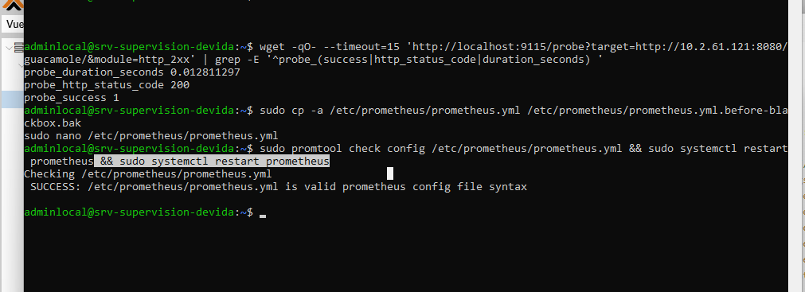

*Figure 420 — Validation du fichier Prometheus par promtool avant redémarrage. Source : `Screenshots/Capture d'écran 2026-11-26 111319.png`.*

Dans Grafana, exécuter :

```promql
probe_success{job="guacamole_web"}
```

Une réponse HTTP réussie ne teste pas l’authentification au portail ni l’ouverture d’une session RDP. Le panneau est donc nommé **Disponibilité web Guacamole**.

## 2.10 Créer le tableau AP2 — Supervision DEVIDA

Créer un tableau de bord, ajouter un panneau, choisir la source `prometheus` et coller la requête de disponibilité. Sélectionner la visualisation **Stat**, le calcul de dernière valeur, puis définir les correspondances :

| Valeur | Texte | Couleur |
| --- | --- | --- |
| 1 | Disponible | Vert |
| 0 | Indisponible | Rouge |

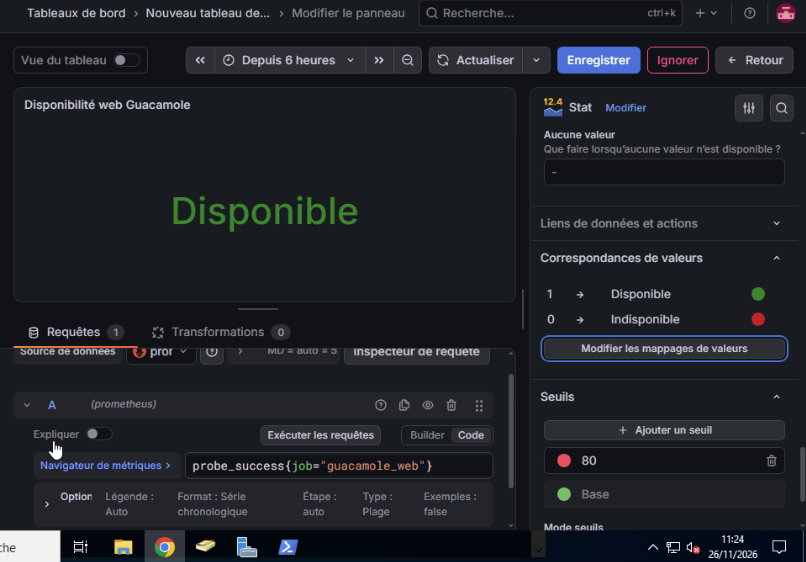

*Figure 432 — Panneau de disponibilité Guacamole avec les correspondances 1 et 0. Source : `Screenshots/Capture d'écran 2026-11-26 112517.png`.*

Pour un indicateur d’état courant, privilégier une requête instantanée. Une réduction « dernière valeur non nulle » sur une longue plage peut continuer à afficher une ancienne valeur après une interruption de collecte. Ce réglage est une recommandation de consolidation ; son application finale n’est pas démontrée par les captures.

Ajouter ensuite le panneau **État des services AD** avec :

```promql
windows_service_state{
  job="windows",
  instance="10.2.61.100:9182",
  service=~"(?i)(NTDS|DNS|DHCPServer|Netlogon)",
  state="running"
}
```

La requête retourne quatre séries distinctes, chacune égale à `1`. Le label est `service` dans la version installée. [Documentation du collecteur service](https://github.com/prometheus-community/windows_exporter/blob/v0.32.1/docs/collector.service.md).

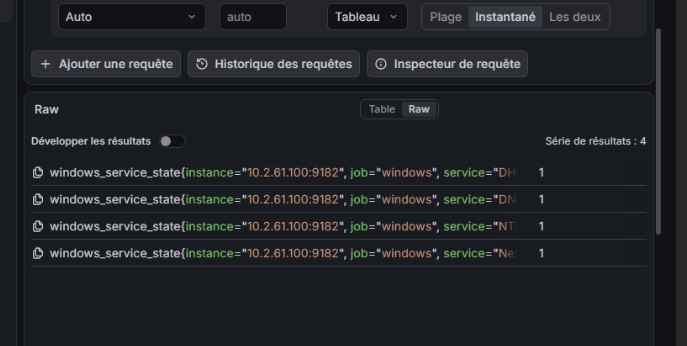

*Figure 459 — Quatre séries de services Windows retournent la valeur 1. Source : `Screenshots/Capture d'écran 2026-11-26 141450.png`.*

Définir la légende `{{service}}`, puis les correspondances **1 → Démarré** en vert et **0 → Arrêté** en rouge. Enregistrer le tableau.

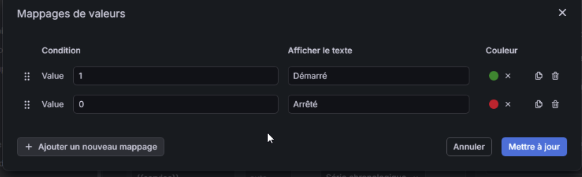

*Figure 462 — Correspondances de valeurs : 1 = Démarré, 0 = Arrêté. Source : `Screenshots/Capture d'écran 2026-11-26 142526.png`.*

| Service | Utilité |
| --- | --- |
| NTDS | Service d’annuaire Active Directory Domain Services |
| DNS | Résolution des noms, notamment les enregistrements du domaine |
| DHCPServer | Attribution automatique des paramètres réseau |
| Netlogon | Fonctions de connexion au domaine et maintien du canal sécurisé |

L’état « Démarré » décrit le service Windows. Il ne suffit pas à garantir la réplication AD, la qualité des réponses DNS ou la disponibilité des baux DHCP. Ces tests fonctionnels restent des extensions possibles.
