# 3 — Configurer les alertes par e-mail et valider le résultat

[Rapport AP2](README.md) · [Précédent : supervision](02-SUPERVISION.md)

## 3.1 Objectif

Les tableaux de bord nécessitent d’être consultés. Les alertes ajoutent une notification automatique lorsque la page web Guacamole ne répond plus correctement ou qu’un des quatre services Windows suivis n’est plus démarré. Grafana évalue les règles et envoie les e-mails via un compte Gmail dédié.

Deux niveaux sont vérifiés séparément : l’envoi d’un message de test depuis le point de contact, puis le déclenchement d’une vraie règle avec un seuil temporaire. Cette seconde vérification contrôle également l’évaluation, l’attente et l’association au destinataire.

## 3.2 Préparer le compte d’envoi

Le compte **devida.supervision@gmail.com** est créé pour la supervision. La validation en deux étapes est activée, puis un mot de passe d’application nommé **Grafana DEVIDA** est créé. Le secret est saisi localement dans la configuration SMTP ; il ne figure ni dans ce rapport ni dans les fichiers publiables.

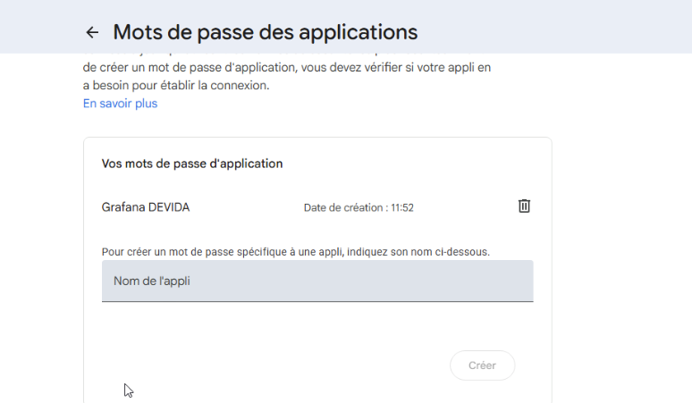

*Figure 442 — Mot de passe d’application Grafana DEVIDA créé dans Google ; secret non affiché. Source : `Screenshots/Capture d'écran 2026-11-26 115346.png`.*

Deux captures de l’archive contenaient ce secret en clair : elles sont exclues. Comme ce mot de passe a été partagé dans des captures, sa révocation puis son remplacement dans Google et Grafana restent à effectuer si cela n’a pas déjà été fait. Le rapport ne prétend pas que ce renouvellement a été réalisé.

## 3.3 Configurer SMTP dans Grafana

Sur **SRV-SUPERVISION-DEVIDA**, ouvrir `/etc/grafana/grafana.ini` avec les droits administrateur et rechercher la section `[smtp]`. Modifier les lignes existantes plutôt que de créer une seconde section. Les lignes actives ne doivent pas commencer par `;`.

```bash
sudo nano /etc/grafana/grafana.ini
```

Configuration reconstituée, disponible aussi dans [grafana-smtp.ini.example](configurations/grafana-smtp.ini.example) :

```ini
[smtp]
enabled = true
host = smtp.gmail.com:587
user = devida.supervision@gmail.com
password = REMPLACER_PAR_LE_MOT_DE_PASSE_APPLICATION
skip_verify = false
from_address = devida.supervision@gmail.com
from_name = Supervision DEVIDA
ehlo_identity = srv-supervision-devida.devida.local
startTLS_policy = MandatoryStartTLS
```

Le port 587 est utilisé avec STARTTLS obligatoire. `skip_verify = false` conserve la vérification du certificat. Le champ `password` reçoit le mot de passe d’application, sans les espaces de présentation de Google. [Référence SMTP Grafana](https://grafana.com/docs/grafana/latest/setup-grafana/configure-grafana/#smtp).

Après enregistrement dans Nano, les permissions sont limitées à `root` et au groupe `grafana`, puis le service est redémarré :

```bash
sudo chown root:grafana /etc/grafana/grafana.ini
sudo chmod 640 /etc/grafana/grafana.ini
sudo systemctl restart grafana-server
systemctl is-active grafana-server
```

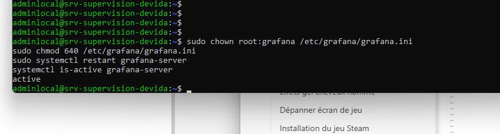

*Figure 447 — Permissions du fichier grafana.ini et redémarrage du service Grafana, état active. Source : `Screenshots/Capture d'écran 2026-11-26 121535.png`.*

## 3.4 Créer le point de contact

Dans Grafana, ouvrir **Alerte → Configuration des notifications → Points de contact → Nouveau point de contact**.

| Champ | Valeur retenue |
| --- | --- |
| Nom | Email-DEVIDA |
| Intégration | Email |
| Addresses | devida.supervision@gmail.com |

Cliquer sur **Test**, envoyer une notification puis vérifier la boîte mail. Le message **[FIRING:1] TestAlert Grafana** démontre que l’envoi SMTP aboutit. Il ne correspond pas à une panne réelle.

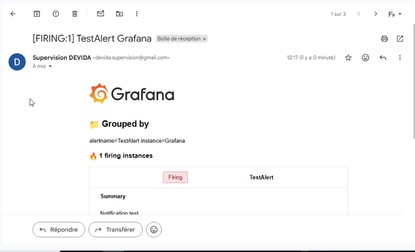

*Figure 449 — Réception du message TestAlert envoyé par le point de contact Grafana. Source : `Screenshots/Capture d'écran 2026-11-26 121832.png`.*

Enregistrer le point de contact. La mention **Inutilisé** visible à cette étape signifie qu’aucune règle ne lui est encore associée, même si l’e-mail de test fonctionne.

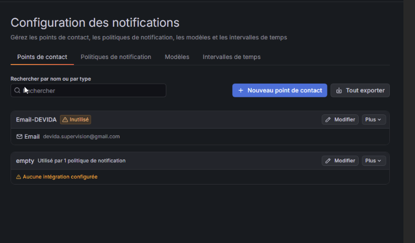

*Figure 450 — Point de contact Email-DEVIDA créé ; à ce stade il n’est pas encore affecté à une règle. Source : `Screenshots/Capture d'écran 2026-11-26 121922.png`.*

## 3.5 Créer l’alerte Guacamole

Ouvrir **Alerte → Règles d’alerte → Nouvelle règle d’alerte**. Les paramètres finaux attendus sont :

| Paramètre | Valeur |
| --- | --- |
| Nom | Guacamole — Page web indisponible |
| Source | prometheus |
| Requête | `probe_success{job="guacamole_web"}` |
| Type | Instantané |
| Condition | **IS BELOW 1** |
| Dossier | AP2-DEVIDA |
| Groupe d’évaluation | supervision-devida |
| Intervalle du groupe | 30s |
| Période en attente | 2m |
| Continuer à déclencher pour | Aucun |
| Point de contact | Email-DEVIDA |
| Summary | La page web Guacamole est indisponible depuis au moins 2 minutes. |

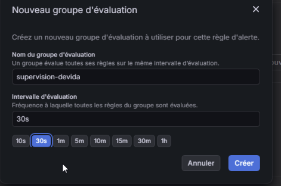

*Figure 438 — Groupe supervision-devida avec un intervalle d’évaluation de 30 secondes. Source : `Screenshots/Capture d'écran 2026-11-26 113626.png`.*

La condition doit être **inférieure à 1**, puisque `1` indique une réponse réussie et `0` un échec. La condition initiale proposée par l’interface, `IS ABOVE 0`, déclencherait au contraire lorsque la page fonctionne.

Après avoir enregistré la règle, consulter son état et la date de dernière évaluation. Le délai d’attente évite qu’un échec isolé envoie immédiatement un message. Le fonctionnement des règles et de l’évaluation est décrit dans la [documentation des règles gérées par Grafana](https://grafana.com/docs/grafana/latest/alerting/alerting-rules/create-grafana-managed-rule/).

## 3.6 Tester l’alerte sans arrêter Guacamole

Le test réalisé modifie temporairement le seuil à **IS BELOW 2** alors que la métrique vaut `1`. La condition devient vraie sans provoquer une interruption du portail.

1. Noter le seuil normal : `IS BELOW 1`.
2. Enregistrer temporairement `IS BELOW 2`.
3. Attendre les évaluations : la règle passe à **Pending**.
4. Après la période d’attente, vérifier le passage à **Firing** et la réception du mail.
5. Remettre **IS BELOW 1**, enregistrer et vérifier le retour à **Normal**.

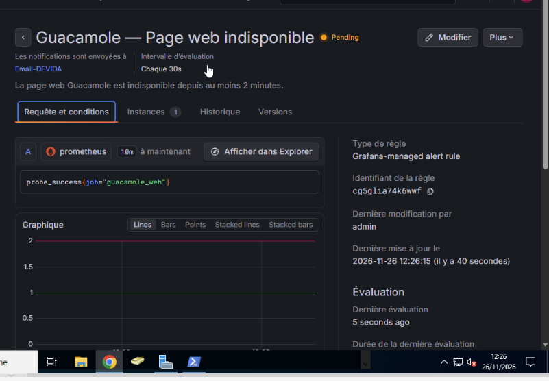

*Figure 454 — Test de la règle Guacamole : état Pending avec seuil temporaire à 2. Source : `Screenshots/Capture d'écran 2026-11-26 122731.png`.*

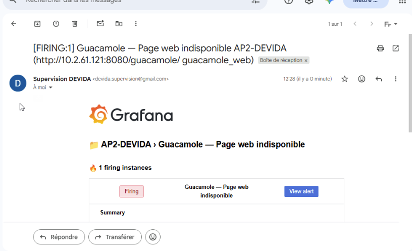

*Figure 455 — Mail FIRING reçu pour l’alerte Guacamole durant le test simulé. Source : `Screenshots/Capture d'écran 2026-11-26 123012.png`.*

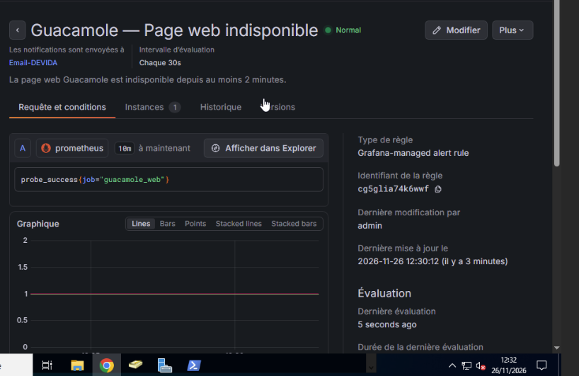

*Figure 456 — Retour de la règle Guacamole à l’état Normal après remise du seuil normal. Source : `Screenshots/Capture d'écran 2026-11-26 123331.png`.*

Ce test valide le circuit de notification d’une règle. Il ne prouve pas qu’une véritable coupure réseau, un arrêt du conteneur ou une panne de base a été simulé à cet instant.

## 3.7 Créer l’alerte des services AD

Créer la règle **AD — Service essentiel arrêté**, avec une requête instantanée qui conserve une série par service :

```promql
windows_service_state{
  job="windows",
  instance="10.2.61.100:9182",
  service=~"(?i)(NTDS|DNS|DHCPServer|Netlogon)",
  state="running"
}
```

Retenir **IS BELOW 1**, le dossier `AP2-DEVIDA`, le groupe `supervision-devida` évalué toutes les **30 secondes**, une attente de **2 minutes** et le point de contact `Email-DEVIDA`. Ne pas agréger les quatre séries en une moyenne : les labels permettent d’identifier le service concerné.

Le résumé utilise les étiquettes de l’instance :

```text
Le service {{ $labels.service }} sur {{ $labels.instance }} n’est plus démarré depuis au moins 2 minutes.
```

L’écran de définition peut afficher ce modèle littéralement ; son remplacement intervient dans le contexte d’une instance d’alerte.

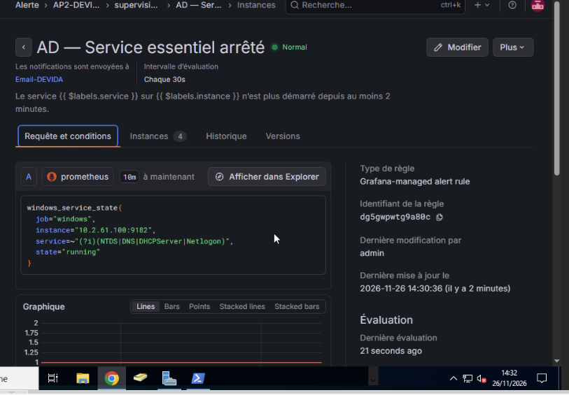

*Figure 464 — Règle AD — Service essentiel arrêté enregistrée, quatre instances et état Normal. Source : `Screenshots/Capture d'écran 2026-11-26 143252.png`.*

## 3.8 Tester les notifications AD

Le test documenté utilise le même principe de seuil temporaire. Avec quatre services à `1`, un seuil inférieur à `2` déclenche quatre instances. Le mail FIRING montre le nom du service dans le message. Les services AD n’ont pas besoin d’être arrêtés pour ce test.

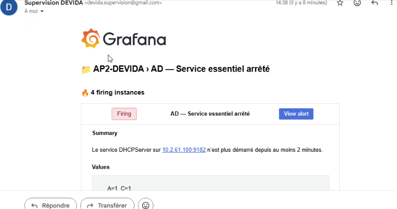

*Figure 466 — Mail de déclenchement des quatre instances AD ; nom du service injecté dans le message. Source : `Screenshots/Capture d'écran 2026-11-26 144749.png`.*

Un mail **RESOLVED**, avec **4 resolved instances**, confirme ensuite la résolution des instances.

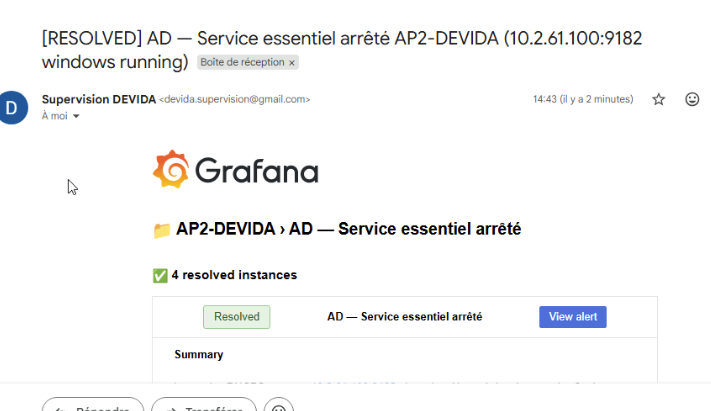

*Figure 465 — Mail de résolution de quatre instances de l’alerte AD. Source : `Screenshots/Capture d'écran 2026-11-26 144724.png`.*

**Limite de preuve :** un mail de résolution ne suffit pas à vérifier le seuil définitivement enregistré. Avant la remise du rapport, rouvrir la règle et contrôler **IS BELOW 1**, ainsi que le retour des quatre instances à l’état Normal. La résolution ne doit pas être présentée comme une preuve de redémarrage de l’AD.

## 3.9 Comprendre les délais et les absences de données

La collecte normale intervient toutes les 15 secondes. L’évaluation Grafana se fait toutes les 30 secondes, puis la condition doit rester vraie pendant 2 minutes. Le regroupement des notifications et le transport SMTP ajoutent éventuellement un délai. Il s’agit d’une supervision périodique avec historique, pas d’un affichage instantané à la milliseconde.

La valeur `0` d’un service et l’absence totale de métriques ne sont pas équivalentes. Si Windows Exporter ou le serveur s’arrête, la série de service peut disparaître au lieu de prendre la valeur `0`. La politique **No data / Error** des règles doit donc être examinée. Son réglage final n’est pas démontré dans les captures.

Améliorations proposées, non réalisées dans les preuves :

- Ajouter une règle sur `up{job="windows",instance="10.2.61.100:9182"}` pour détecter l’échec de collecte de l’AD.
- Ajouter une règle sur `up{job="guacamole_web"}` pour distinguer une sonde injoignable d’une page testée indisponible.
- Définir le traitement des séries disparues et des erreurs de source de données.
- Ajouter des alertes CPU, mémoire et espace disque avec des seuils adaptés au laboratoire.
- Tester des requêtes DNS et LDAP fonctionnelles plutôt que le seul état des services.

## 3.10 Tableau de recette global

| Contrôle | Attendu | Preuve / conclusion |
| --- | --- | --- |
| Connexion RDP Guacamole | Bureau Windows et identité de domaine | Figures 360–361 : observé |
| Connexion SSH Guacamole | Terminal du serveur cible | Figure 365 : observé |
| Collecte Linux | Deux cibles node UP | Figure 396 : observé |
| Collecte Windows | Cible 10.2.61.100:9182 UP | Figure 411 : observé |
| Tableaux de ressources | Graphiques alimentés | Figures 397 et 417 : observé |
| Sonde HTTP | Code 200 et probe_success=1 | Figure 419 : observé |
| Services AD | Quatre services à 1 | Figure 459 : observé |
| SMTP | Réception TestAlert | Figure 449 : observé |
| Règle Guacamole | Pending, Firing, mail et retour normal | Figures 454–456 : observé avec seuil simulé |
| Règle AD | Mail de déclenchement puis de résolution | Figures 466 et 465 : observé avec seuil simulé |
| Seuil final AD | IS BELOW 1 | À contrôler explicitement dans l’éditeur |
| Panne réelle d’un service AD | Détection et résolution fonctionnelles | Non réalisée / non démontrée |
| Absence de métriques | Comportement d’alerte défini | À compléter |
| Sauvegarde puis restauration de la supervision | Retour des tableaux et règles | Non démontrée |

## 3.11 Compétences mobilisées et bilan

La réalisation met en œuvre l’administration de VM Linux et Windows, le diagnostic réseau, la conteneurisation d’une application, la collecte de métriques, l’écriture de requêtes PromQL et la configuration d’une chaîne de notification. Les incidents ont conduit à distinguer un problème de compte Windows, un problème de publication Docker et un problème de requête de tableau de bord.

Le résultat est une plateforme consultable depuis le navigateur, avec des graphiques pour Linux et Windows, des indicateurs applicatifs et des e-mails d’alerte. Le rapport conserve les limites des tests afin de ne pas confondre un résultat visible, une simulation et une validation fonctionnelle complète.
