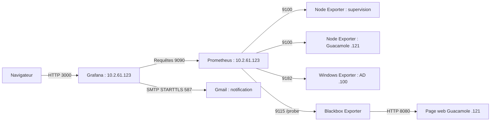

# AP2 — Accès distant et supervision de DEVIDA

> **En langage simple.** Ce projet répond à deux besoins : utiliser une machine à distance et savoir si les services fonctionnent. Guacamole ouvre une porte d’accès depuis un navigateur ; Prometheus collecte les mesures ; Grafana les transforme en graphiques et en alertes. Les trois chapitres ci-dessous suivent cet ordre.
>
> Première lecture : les explications et les captures suffisent. Pour les mots nouveaux, ouvrez le [lexique](../LEXIQUE.md) ou le [parcours de découverte](../GUIDE-DEBUTANT.md).

[Accueil](../README.md) · [Architecture](../00-Infrastructure/README.md)

## Besoin et périmètre

L’objectif est de proposer un accès aux machines depuis un navigateur, puis de suivre leur fonctionnement et d’être averti par e-mail lorsqu’un problème est détecté. Deux VM Debian séparent l’accès distant et la supervision. Le contrôleur de domaine Windows est équipé d’un agent de collecte ; Grafana n’est pas installé sur l’AD.

| Chapitre | Réalisation |
| --- | --- |
| [1. Guacamole](01-GUACAMOLE.md) | VM Debian, Docker Compose, PostgreSQL, connexions RDP et SSH, diagnostic d’un port non publié |
| [2. Supervision](02-SUPERVISION.md) | Prometheus, Grafana, agents Linux et Windows, sonde HTTP, tableaux de bord |
| [3. Alertes et recette](03-ALERTES.md) | Gmail SMTP, règles Guacamole/AD, tests de notification et limites |

## Architecture de collecte

Prometheus conserve les mesures, Grafana les affiche et évalue les règles d’alerte. Node Exporter renseigne l’état du serveur Linux ; la sonde Blackbox contrôle la réponse de la page web Guacamole. Ces contrôles sont complémentaires : un serveur peut fonctionner alors que son application web est arrêtée.

## Paramètres du laboratoire

| Composant | Adresse / version observée | Rôle |
| --- | --- | --- |
| SRV-GUAC-DEVIDA, VM 507 | 10.2.61.121, Debian 13 | Guacamole 1.6.0 et PostgreSQL 17 dans Docker |
| SRV-SUPERVISION-DEVIDA, VM 508 | 10.2.61.123, Debian 13 | Prometheus 2.53.3 (paquet Debian), Grafana 13.3.1 |
| AD principal, VM 500 | 10.2.61.100, Windows Server 2022 | AD DS, DNS, DHCP et Netlogon ; Windows Exporter 0.32.1 |
| Poste Windows | 10.2.61.126 | Destination RDP, compte de domaine nbernard |
| Gmail dédié | devida.supervision@gmail.com | Expéditeur et destinataire des tests |

Les versions sont celles des captures. Une réinstallation sans verrouillage des versions peut installer une version plus récente.

## Fichiers de configuration fournis

Les fichiers ci-dessous sont **reconstitués pour reproduction**, sans mot de passe. Ils ne sont pas des exports complets des machines. Les instructions de chaque chapitre indiquent où les utiliser.

- [Docker Compose Guacamole](configurations/compose.yaml)
- [Prometheus et ses quatre jobs](configurations/prometheus.yml)
- [Module HTTP Blackbox minimal](configurations/blackbox.yml)
- [Exemple SMTP Grafana](configurations/grafana-smtp.ini.example)
- [Installation Windows Exporter](configurations/install-windows-exporter.ps1)
- [Requêtes PromQL](configurations/requetes.promql)

## Bilan

Les preuves montrent des accès RDP/SSH, les cibles de collecte en état UP, des graphiques CPU/mémoire/disque, l’état de quatre services Windows et la réception de notifications. Les tests d’alerte ont utilisé des seuils temporaires. Ils vérifient le circuit d’alerte, sans démontrer une panne réelle des services AD.

Les améliorations possibles sont le HTTPS pour les interfaces, une sauvegarde avec essai de restauration, des alertes sur l’absence de collecte et les ressources, ainsi que des contrôles fonctionnels DNS/LDAP. Elles ne sont pas présentées comme déjà réalisées.
