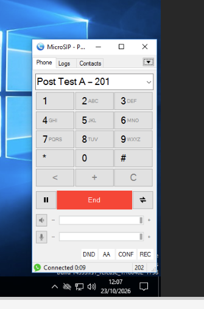
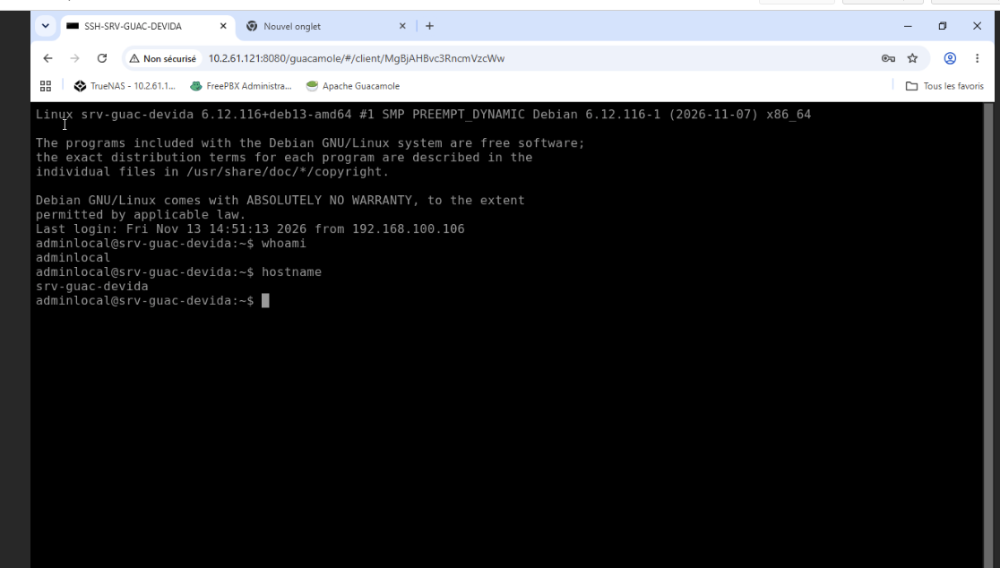
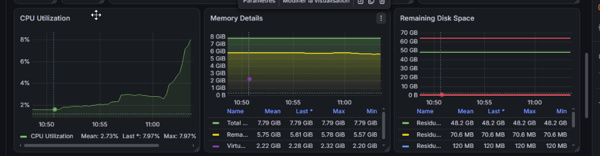

# Comprendre DEVIDA sans connaissances techniques

[Accueil](README.md) · [Lexique](LEXIQUE.md)

**À la fin de cette lecture, vous pourrez expliquer à quoi servent les projets, comment leurs outils coopèrent et ce qui a réellement été vérifié.** Les commandes d’installation sont dans les rapports détaillés ; vous n’avez pas besoin de les exécuter pour comprendre.

## 1. Le point de départ : plusieurs besoins dans un même laboratoire

Une organisation utilise des services directement utiles aux employés, comme le téléphone, et des outils pour l’administrateur, qui doit entretenir et surveiller les machines. DEVIDA rassemble ces usages dans un environnement d’apprentissage.

Un ordinateur physique héberge plusieurs **machines virtuelles** : chacune se comporte comme un ordinateur distinct, avec son système, sa mémoire et son disque. Certaines utilisent Windows, d’autres Debian, un système de la famille Linux. Le logiciel **Proxmox** permet de créer et gérer ces machines. Si l’ordinateur physique s’arrête, les machines virtuelles qu’il héberge s’arrêtent aussi.

| Élément | Son rôle, simplement |
| --- | --- |
| Serveur d’identité | Gérer les comptes du domaine DEVIDA et fournir des services réseau |
| Serveur téléphonique | Relier les deux numéros internes |
| Serveur d’accès distant | Donner accès à des postes depuis un navigateur |
| Serveur de surveillance | Collecter les mesures, les afficher et envoyer les alertes |
| Postes de test | Utiliser les services et vérifier leur fonctionnement |

## 2. Quelques repères pour comprendre le réseau

Une **adresse IP**, comme `10.2.61.123`, sert à identifier une machine sur le réseau. Un **port**, comme `3000`, distingue un service sur cette machine. L’adresse `http://10.2.61.123:3000` signifie donc : « ouvrir le service web du port 3000 de cette machine ». Ces numéros appartiennent au laboratoire et ne sont pas des liens publics.

Le **DNS** associe des noms aux adresses, un peu comme un annuaire. Le **DHCP** attribue automatiquement des paramètres réseau. Une réservation DHCP permet à une machine de retrouver la même adresse.

Le laboratoire sépare les usages en deux réseaux virtuels, appelés **VLAN** : l’un pour les services généraux, l’autre pour la téléphonie. Le logiciel **pfSense** assure le passage entre les réseaux et filtre les communications. Les règles doivent permettre les échanges nécessaires ; une séparation ne les autorise pas automatiquement.

👉 [Voir le détail de l’infrastructure](00-Infrastructure/README.md)

## 3. AP1 : installer un téléphone d’entreprise en version d’essai

### Le besoin et les outils

Deux personnes doivent pouvoir s’appeler avec des numéros internes, ici **201** et **202**. Un logiciel de téléphone sur ordinateur est appelé un **softphone**. MicroSIP est celui utilisé sur le poste Windows.

**FreePBX** fournit les écrans pour créer les numéros et régler le standard. **Asterisk** assure les fonctions téléphoniques en arrière-plan. Chaque poste dispose d’un numéro et d’un secret de connexion pour être reconnu par le serveur. Le secret n’est pas reproduit dans le dépôt.

### Que se passe-t-il pendant un appel ?

1. Le poste 201 se connecte au standard avec ses paramètres.
2. La personne compose 202.
3. Le standard organise l’appel vers l’autre poste.
4. Lorsque l’autre personne décroche, les flux audio peuvent transporter la voix.

**SIP** organise l’appel ; **RTP** transporte l’audio. C’est pourquoi un appel peut être connecté tout en restant silencieux : la connexion et le son doivent être vérifiés séparément.

### Ce qui a été fait et comment lire la preuve

Une machine Debian a été préparée sur le réseau voix, puis FreePBX a été installé. Les postes 201 et 202 ont été créés. Le client Windows a été configuré et un appel a été établi. Une sauvegarde de configuration a aussi été créée.

**À regarder :** le destinataire 202, `Connected` (« connecté ») et le compteur de durée. L’image prouve l’établissement d’un appel. Elle ne permet pas d’entendre la conversation.

Un problème de microphone ou de haut-parleur a été rencontré dans la machine Windows. Le rapport explique le diagnostic et distingue le résultat visible de la confirmation audio donnée pendant les essais.

**L’intérêt du projet :** apprendre à installer un service, créer des comptes de téléphone, autoriser les communications et contrôler le résultat. Il ne comprend pas d’abonnement opérateur ni d’appels vers le réseau téléphonique public.

👉 [Lire l’installation détaillée de l’AP1](AP1-FreePBX/README.md)

## 4. AP2 : ouvrir un poste à distance

### Le besoin

Un administrateur souhaite accéder à plusieurs machines depuis un navigateur. **Apache Guacamole** sert de portail : l’utilisateur s’y connecte, choisit une machine et ouvre une session.

- **RDP :** afficher le bureau Windows et interagir avec ses fenêtres.
- **SSH :** ouvrir un terminal Linux et envoyer des commandes.

La machine distante continue d’exécuter les programmes. Son bureau n’est pas déplacé sur l’ordinateur qui affiche le navigateur.

### Comment les éléments coopèrent

L’application web présente le portail. Un composant nommé `guacd` assure les connexions aux machines. Une base **PostgreSQL** conserve les comptes et les définitions de connexions.

Ces trois composants sont installés dans des **conteneurs Docker**. Un conteneur regroupe un logiciel et ce dont il dépend, tout en partageant le noyau du système qui l’héberge. Ce n’est donc pas exactement une machine virtuelle. **Docker Compose** décrit les composants à lancer et leurs relations.

### Ce qui a été vérifié

Une session a ouvert le bureau Windows. Une autre a ouvert un terminal du serveur Linux. Deux commandes ont permis de vérifier l’identité de l’utilisateur et le nom de la machine.

**À regarder :** `whoami` demande « quel utilisateur suis-je ? » ; `hostname` demande « sur quelle machine suis-je ? ». Les réponses confirment où la session a abouti.

Le portail a ensuite connu un incident : certains composants fonctionnaient, mais le port web n’était pas publié par le conteneur en cours. Ce composant a été recréé à partir de sa configuration, puis l’écran de connexion est réapparu.

**La leçon :** « le serveur est allumé » ne signifie pas « le site fonctionne ». Il faut vérifier le service précis et le chemin qui permet de l’atteindre.

👉 [Lire l’installation détaillée de Guacamole](AP2-Guacamole-Supervision/01-GUACAMOLE.md)

## 5. AP2 : voir ce qui se passe dans les machines

Un ordinateur peut fonctionner tout en manquant de mémoire ou en remplissant son disque. La **supervision** collecte régulièrement des mesures et conserve leur historique.

| Mesure | Ce qu’elle décrit |
| --- | --- |
| CPU | Le travail du processeur, qui exécute les instructions |
| RAM | La mémoire utilisée par les programmes en cours |
| Disque | L’espace occupé et l’activité de stockage |
| Réseau | Les échanges de données |
| État d’un service | Si un programme de fond est démarré ou arrêté |

Une valeur élevée n’est pas toujours une panne. Une mise à jour peut par exemple solliciter fortement le processeur pendant quelques minutes. Le contexte et la durée comptent.

### Prometheus et Grafana

Des agents appelés **exporters** exposent les mesures des machines. **Prometheus** vient les lire régulièrement et les conserve. **Grafana** les transforme en graphiques et en indicateurs.

Node Exporter est utilisé pour Linux ; Windows Exporter pour Windows. Une sonde **Blackbox Exporter** vérifie aussi la réponse de la page Guacamole : elle essaie d’atteindre le site, au lieu de mesurer seulement l’état du serveur.

**À regarder :** les titres, l’heure en bas et l’unité sur le côté. Un pourcentage CPU exprime une proportion de capacité utilisée ; une quantité en Gio exprime un volume de mémoire ou de données. Les courbes permettent de voir une évolution.

La collecte se fait normalement toutes les **15 secondes**. La surveillance est régulière, mais une action n’apparaît pas nécessairement à l’écran à la même seconde.

👉 [Lire l’installation détaillée de la supervision](AP2-Guacamole-Supervision/02-SUPERVISION.md)

## 6. AP2 : être averti par e-mail

Une **règle d’alerte** décrit un problème à surveiller et la durée pendant laquelle il doit persister avant de déclencher un message. La règle Guacamole surveille la réponse de sa page web. La règle Windows surveille quatre services : l’annuaire Active Directory, le DNS, le DHCP et Netlogon.

Le serveur d’identité est souvent appelé **AD** par raccourci. Il centralise notamment des comptes et des règles d’accès ; plusieurs services participent au fonctionnement du domaine.

| Message | Signification |
| --- | --- |
| **Normal** | La condition de problème n’est pas remplie |
| **Pending / En attente** | La condition est remplie, mais le délai n’est pas terminé |
| **Firing / Déclenchée** | La condition a persisté assez longtemps |
| **Resolved / Résolue** | L’instance a quitté l’état déclenché ; cela n’indique pas à lui seul la cause du retour |

Les règles sont évaluées toutes les **30 secondes**, avec une attente de **2 minutes**. Le regroupement et le transport des e-mails peuvent ajouter un délai.

### Tester sans provoquer une panne

La disponibilité vaut `1` quand le contrôle réussit et `0` quand il échoue. La règle normale déclenche pour une valeur **inférieure à 1**. Pour tester, le seuil est temporairement changé en **inférieure à 2** : même le résultat normal `1` provoque alors une alerte. Le seuil normal doit ensuite être rétabli.

Ce test démontre que l’évaluation et l’envoi des notifications fonctionnent. **Il ne démontre pas qu’une panne réelle des services AD a été provoquée ou réparée.**

👉 [Lire les réglages et les tests d’alerte](AP2-Guacamole-Supervision/03-ALERTES.md)

## 7. Pourquoi expliquer aussi les erreurs ?

Un compte rendu utile montre le raisonnement : **le symptôme**, **le contrôle réalisé**, **l’explication appuyée sur les résultats**, puis **la correction et sa vérification**.

Une sauvegarde créée n’est pas encore une restauration testée. Un service marqué « Démarré » ne prouve pas que toutes ses fonctions répondent correctement. Les rapports conservent ces distinctions pour que chacun puisse juger le résultat.

[Revenir aux rapports](README.md) · [Comprendre un mot](LEXIQUE.md) · [Réutiliser le modèle de compte rendu](MODELE-FICHE.md)
