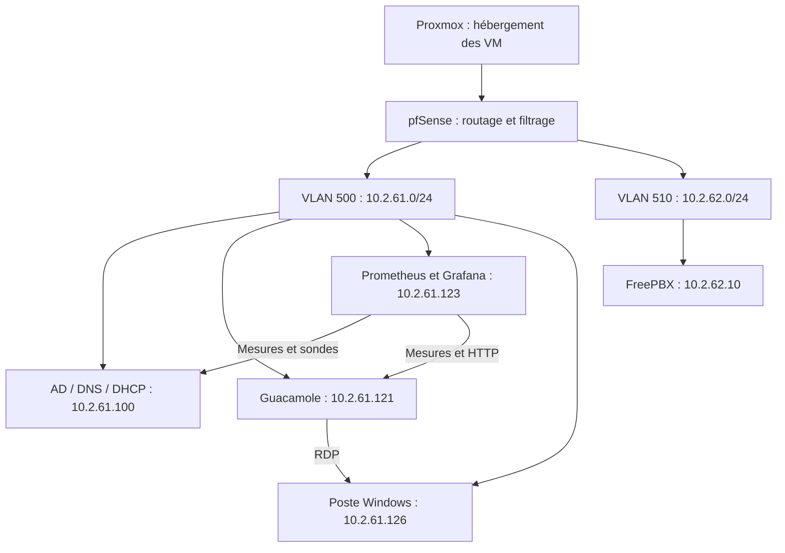

# AD-DEVIDA — Rapports techniques AP1 et AP2

**BTS SIO — option SISR · Yan Brette · Laboratoire virtualisé sur Proxmox**

Ce dossier présente les réalisations de téléphonie IP, d’accès distant et de supervision du laboratoire DEVIDA. Les rapports expliquent les configurations, les commandes, les vérifications et les incidents à partir des captures fournies et des échanges de réalisation.

| Réalisation | Objectif | Rapport |
| --- | --- | --- |
| Socle commun | Situer Proxmox, pfSense, les VLAN et les services AD/DNS/DHCP | [Architecture et infrastructure](00-Infrastructure/README.md) |
| AP1 | Installer un standard téléphonique FreePBX et établir des appels internes | [Rapport FreePBX](AP1-FreePBX/README.md) |
| AP2 | Centraliser les accès RDP/SSH et superviser les serveurs | [Rapport Guacamole et supervision](AP2-Guacamole-Supervision/README.md) |
| Annexes | Retrouver les preuves et réutiliser la structure de rédaction | [Sélection des captures](SELECTION-CAPTURES.md) · [Inventaire des 99 images retenues](INVENTAIRE-CAPTURES.csv) · [Modèle de fiche](MODELE-FICHE.md) · [Sources et méthode](SOURCES.md) |

## Lire les preuves

Les captures couvrent septembre à novembre 2026. Les dates indiquées sont celles des noms de fichiers et des écrans ; elles ne constituent pas une vérification de la synchronisation horaire des machines.

Les blocs de code sont distingués ainsi :

- **Observé** : commande ou résultat visible dans une capture, ou opération confirmée pendant la réalisation.
- **Reconstitué pour reproduction** : procédure remise au propre à partir de la configuration et de la documentation ; ce n’est pas un export intégral de l’historique du terminal.
- **À vérifier / amélioration** : opération non démontrée comme effectuée dans le laboratoire.

Les paramètres anciens, les écrans non encore remplis et les erreurs sont légendés comme tels. Les rapports ne prétendent pas que les exemples ont été réexécutés pour leur rédaction. Les adresses privées correspondent au laboratoire ; les secrets sont absents du dépôt.

## Vue d’ensemble

## Résultats établis

L’AP1 dispose de deux extensions PJSIP et d’une capture d’appel connecté. La validation audio Windows/Android a été confirmée dans les échanges ; aucune capture ne peut, seule, prouver la qualité du son. Une sauvegarde FreePBX est visible.

L’AP2 dispose de sessions Guacamole RDP et SSH fonctionnelles, de cibles Prometheus accessibles, de graphiques Linux/Windows et de notifications d’alerte reçues. Les tests de déclenchement ont été effectués en modifiant temporairement les seuils ; aucun arrêt réel de l’AD n’est présenté comme testé.

## Éléments à compléter avant remise au professeur

1. Renseigner l’établissement, la classe et les éventuelles fiches imposées par le professeur.
2. Vérifier le seuil final de l’alerte AD dans l’écran d’édition : `IS BELOW 1`. Le mail de résolution confirme le changement d’état, pas à lui seul ce réglage.
3. Si demandé, joindre l’export réel des tableaux Grafana et des configurations après retrait des secrets. Les exemples fournis ici sont des reconstitutions documentées.
4. Ajouter une preuve de restauration FreePBX si ce test est réalisé ; à ce stade seule la création de sauvegarde est démontrée.

Ce dossier fournit une structure de rapport technique ; il ne remplace pas les consignes d’évaluation de l’établissement.
